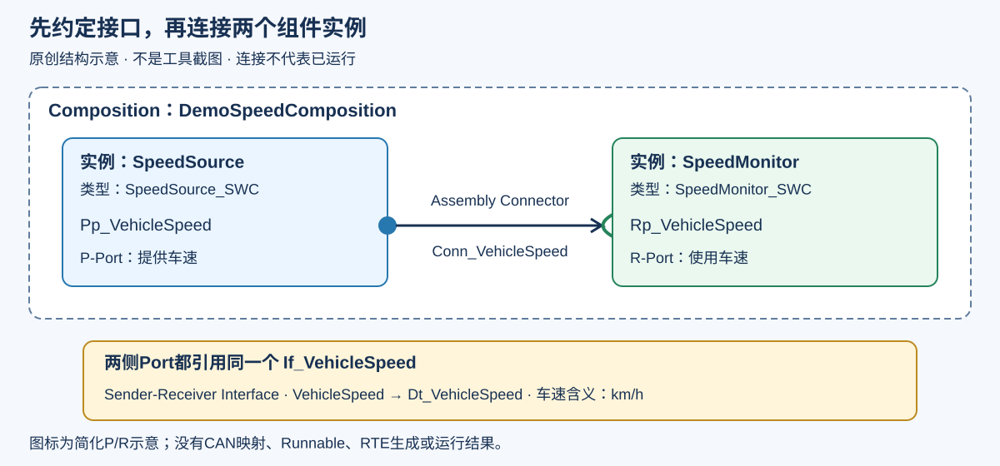

# 第07期 · Vector DaVinci 工具链入门

本期只解决一个问题：**两个软件组件怎样通过 Interface 和 Port 建立结构连接？**

第05期认识了模型内的信号连接，第06期区分了电气波形、总线报文和内部变量。本期转到 AUTOSAR Classic 的软件结构：先说清“谁提供、谁使用、双方约定什么”，再连线。

**CSDN 第07期：正式发布链接待补充。** 文章侧重工具入门和操作讲解；本目录提供独立设计的车速练习、对象表和结构核对表，不复刻文章全文或老师案例。

本期为原创教学设计，不含企业资料、课程原件或商业项目截图。仅覆盖 SWC、ECU Composition、Interface、Port 与组件连接。Runnable、AccessPoints、Port初始值、实现类型映射、完整RTE配置及运行验证不在本期完成范围。

## 先看这张图

图是原创结构示意，不是 DaVinci 软件截图。连线是软件组件间的逻辑连接，不是 CAN 线，也不等于车速已经传输。

| 对象 | 通俗理解 | 本例名称 |
| --- | --- | --- |
| SWC 类型 | 一类软件组件的定义 | SpeedSource_SWC、SpeedMonitor_SWC |
| Composition | 将组件实例组织在一起的容器 | DemoSpeedComposition |
| 组件原型/实例 | 把某个组件类型放入容器后的一次使用 | SpeedSource、SpeedMonitor |
| Interface | 双方共同使用的数据约定 | If_VehicleSpeed |
| P-Port | 本例提供数据的一侧 | Pp_VehicleSpeed |
| R-Port | 本例使用数据的一侧 | Rp_VehicleSpeed |

这里采用 Sender-Receiver Interface（发送接收接口），只放一个数据元素 VehicleSpeed。P/R 的解释限定于本例发送接收通信，不把所有接口都当成车速信号。

## 文件怎么用

| 文件 | 用途 |
| --- | --- |
| [接口约定](examples/interface_contract.csv) | 记录接口、数据元素、应用数据类型和物理含义 |
| [组件与端口表](examples/components_ports.csv) | 对照组件类型、实例、P/R方向和接口引用 |
| [连接表](examples/connections.csv) | 记录一个Assembly Connector的两端 |
| [结构图](diagrams/component_connection.svg) | 对照类型、实例、端口和Composition边界 |
| [工具职责与安装准备](docs/toolchain_setup.md) | Developer/Configurator区别、驱动与许可证检查 |
| [练习和答案](exercises/README.md) | 按步骤搭建、三处辨错和自测 |
| [验证记录](VALIDATION.md) | 静态检查范围与尚未执行的软件操作 |

**三个CSV是自定义学习记录表，不是ARXML、DBC，也不是DaVinci导入格式。** 本期不提供未经验证的工程或自动生成脚本；可直接在GitHub上阅读、对照填写。

## 动手步骤

先完成 [安装准备](docs/toolchain_setup.md)，在具备适用许可的独立练习环境操作。工具版本不同，菜单和对象位置可能不同，按所用版本帮助定位对象。

1. **新建独立Developer工作区/练习工程。** 记录Developer版本和项目AUTOSAR版本，不打开公司或老师工程来改名。
2. **准备一个应用数据类型。** 本例用 Dt_VehicleSpeed 表示车速这一数值类型；物理含义约定为 km/h、0～250。若模板要求先填写数据类型属性，按该版本帮助创建并在两侧引用同一个类型。本期不展开实现类型及映射，CSV中的单位和范围不会自动配置进工具。
3. **新建 Sender-Receiver Interface。** 命名 If_VehicleSpeed，添加一个数据元素 VehicleSpeed，并让它引用 Dt_VehicleSpeed。接口不只是一个名称，还包括种类、数据元素及其类型。
4. **新建两个应用SWC类型。** 分别命名 SpeedSource_SWC 和 SpeedMonitor_SWC。本期只定义边界，不实现车速计算或显示算法。
5. **在类型上添加Port。** Source建P-Port：Pp_VehicleSpeed；Monitor建R-Port：Rp_VehicleSpeed。两者都选择已有的 **同一个 If_VehicleSpeed 对象**，不要分别建两个同名接口。
6. **创建Composition并放入组件。** 创建 DemoSpeedComposition，加入 SpeedSource 与 SpeedMonitor 两个组件原型，分别引用上面两个SWC类型。类型是定义，放入Composition的是该类型的使用实例。
7. **连接实例上的Port。** 在Composition内，将 SpeedSource.Pp_VehicleSpeed 连接到 SpeedMonitor.Rp_VehicleSpeed，建立本例Assembly Connector：Conn_VehicleSpeed。检查方向、所属实例、接口引用和数据元素类型。
8. **保存并检查。** 对照三个CSV逐项核对，执行工具提供的结构/一致性检查。没有后续行为配置时，可能仍有其他未完成项；逐条记录，不把整体工程写成已通过，更不声称RTE或车速传输已运行。

本例使用同一个接口引用来减少入门歧义；更复杂的接口兼容和映射规则不在本期展开。端口名称不同并不妨碍按兼容约定连接；端口名字相似也不能证明接口兼容。

## 本次做到哪里算完成？

- 能在Composition中找到两个实例及各自引用的SWC类型。
- 两个Port方向正确，接口引用一致，数据元素与类型可追溯。
- 连接两端与 [连接表](examples/connections.csv) 一致。
- 能说清“结构已连接”与“软件已运行”的区别，并记录工具检查中的未完成项。

软件操作、工程检查、保存重开及任何运行结果均待实际验证，见 [VALIDATION.md](VALIDATION.md)。

[Vector Developer官方说明](https://www.vector.com/en/product/microsar-classic/davinci-developer-classic/) · [Configurator官方说明](https://www.vector.com/en/product/microsar-classic/davinci-configurator-classic/) · [AUTOSAR VFB概念参考](https://www.autosar.org/fileadmin/standards/R20-11/CP/AUTOSAR_EXP_VFB.pdf)

[上一期](../../can-tools/06-can-bus-tools-practice/README.md) · [项目目录与分类](../../README.md) · [仓库首页](../../../README.md)
