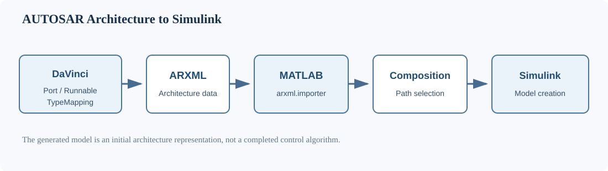

# 第09期 · AUTOSAR ARXML 导入与 Simulink Composition 模型生成

本项目围绕 AUTOSAR 架构配置完成后的下一步工作展开：整理 Runnable 数据访问关系、数据类型映射，并使用 MATLAB 导入 ARXML，获取 Composition 路径和生成初始 Simulink 模型。

**CSDN 第09期：[AUTOSAR架构配置进阶——从Port初始值、AccessPoints到Simulink模型生成](https://blog.csdn.net/qian123456wang/article/details/170491918?spm=1001.2014.3001.5501)**

两边内容分工：

- CSDN：讲解 DaVinci 配置过程、概念和操作界面。
- GitHub：提供原创数据表、MATLAB 辅助函数、工程检查清单和独立练习。

## 1. 本项目解决什么问题？

完成 SWC、Interface、Port 和 Composition 的基本配置后，还需要进一步梳理：

1. Receiver Port 的初始值。
2. Runnable 对输入、输出数据的访问关系。
3. Application Data Type 与 Implementation Data Type 的映射。
4. ARXML 文件导入 MATLAB 后如何查找 Composition。
5. 如何创建对应的 Simulink Composition 模型。

本项目重点练习第4、5项，并通过独立 CSV 示例辅助理解前3项。

## 2. 整体流程



```text
DaVinci Developer
       |
       v
Port / AccessPoints / TypeMapping
       |
       v
Export ARXML
       |
       v
MATLAB: arxml.importer
       |
       v
getComponentNames
       |
       v
createCompositionAsModel
       |
       v
Simulink SWC / Composition models
```

## 3. 文件说明

| 文件 | 用途 |
|---|---|
| examples/component_access_points.csv | Runnable 数据读写关系 |
| examples/receiver_init_values.csv | Receiver Port 初始值记录 |
| examples/data_type_mapping.csv | ADT 与 IDT 对应关系 |
| examples/composition_connections.csv | Composition 组件连接关系 |
| scripts/inspect_arxml_compositions.m | 导入 ARXML 并列出 Composition |
| scripts/create_composition_model.m | 根据选定路径创建 Composition 模型 |
| exercises/README.md | 独立练习与检查清单 |
| VALIDATION.md | 验证状态及未完成事项 |

注意：CSV 是原创教学记录表，不是 DaVinci 可直接导入的 ARXML 文件，也不是 AUTOSAR 标准配置文件。

## 4. MATLAB 环境准备

需要安装：

- MATLAB
- Simulink
- AUTOSAR Blockset

建议在独立练习文件夹中操作。

将自己导出的 ARXML 文件及其依赖文件放到工作目录中。实际文件名和数量以自己的工程为准。

本仓库不提供未经实际工具验证的 ARXML 工程或 SLX 文件。

## 5. 导入并查看 Composition

进入项目目录后：

```matlab
addpath(fullfile(pwd, 'scripts'));
```

单文件导入：

```matlab
[ar, compositionPaths] = inspect_arxml_compositions( ...
    'VCU_Lab_Composition.arxml');
```

如果有独立的数据类型或接口依赖文件，可以一起导入：

```matlab
[ar, compositionPaths] = inspect_arxml_compositions({ ...
    'VCU_Lab_Composition.arxml', ...
    'VCU_Lab_DataTypes.arxml'});
```

上述文件名均为原创教学示例，必须替换成自己实际存在的文件。

查看返回的 Composition：

```matlab
disp(compositionPaths);
```

注意：

`compositionPaths` 是 Composition 路径集合。如果存在多个 Composition，需要根据实际需求选择，不要默认第一项就是目标。

## 6. 创建 Composition 模型

例如选择第一个 Composition：

```matlab
[model, status] = create_composition_model( ...
    ar, compositionPaths, 1);
```

函数会检查当前目录和已加载模型中的同名模型，避免直接覆盖已有文件。

创建完成后检查：

```matlab
disp(model);
disp(status);
```

`status` 为 true 表示创建成功，false 表示创建失败。

## 7. 需要特别注意

- ARXML 文件必须包含目标 Composition 所需的依赖定义。
- 不同 ARXML 文件之间的引用必须完整。
- 多个 Composition 应根据路径明确选择。
- 创建前检查同名模型文件。
- 生成模型不等于 SWC 内部算法已经完成。
- 生成模型不等于 RTE 集成、代码生成或实车验证通过。

## 8. 本期完成标准

- 能够使用 MATLAB 导入独立 ARXML 文件。
- 能够读取 Composition 路径。
- 能够解释导入对象、Composition 路径和模型句柄。
- 能够使用辅助函数创建模型。
- 能够区分模型生成成功与后续集成验证成功。

具体执行状态见 [VALIDATION.md](VALIDATION.md)。

## 参考资料

- [MathWorks: arxml.importer](https://www.mathworks.com/help/autosar/ref/arxml.importer.html)
- [MathWorks: getComponentNames](https://www.mathworks.com/help/autosar/ref/arxml.importer.getcomponentnames.html)
- [MathWorks: createCompositionAsModel](https://www.mathworks.com/help/autosar/ref/arxml.importer.createcompositionasmodel.html)

## 相关内容

- [第07期：Vector DaVinci 工具链入门](../07-davinci-toolchain/)
- [CSDN 第09期文章](https://blog.csdn.net/qian123456wang/article/details/170491918?spm=1001.2014.3001.5501)
- [返回 AUTOSAR 项目目录](../README.md)
- [返回仓库首页](../../../README.md)

