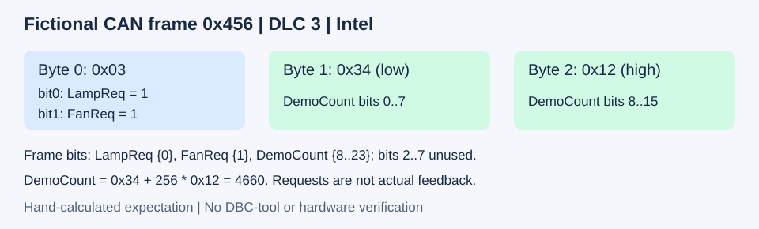

# 通信矩阵中的信号边界练习

CAN与DBC主题下的一个小练习：区分独立信号与同一数值的跨字节编码。具体位宽以信号定义为准，本例仅用两个字节演示。

配套CSDN文章：《VCU入门笔记③：Excel通信协议怎么整理？分清独立信号与高低字节》。[阅读CSDN配套文章](https://blog.csdn.net/qian123456wang/article/details/168873109?spm=1001.2014.3001.5501)。

文章讲概念与整理思路；本目录提供下载文件、位分布图、操作任务和核对结果，不收录文章全文。所有内容均为独立设计的虚构教学数据，无需硬件，不用于实车控制。

[返回CAN与DBC主题目录](../README.md)

## 配套文件

- [整理前反例](examples/before_ambiguous.csv)：刻意把两个独立请求挤在一行，用于辨错，不作为转换输入。
- [整理后矩阵](examples/after_matrix.csv)：一行一个信号。
- [DBC示例](examples/demo_signal_boundaries.dbc)：一条报文、三个信号。
- [虚构报文及预期](examples/sample_frames.csv)：手工构造的对照表，非ASC回放文件。
- [详细练习与答案](practice.md)：读表、手算、改值、找错。
- [验证记录](VALIDATION.md)：区分已完成检查与待验证事项。

## 最小约定

标准帧0x456=十进制1110，DLC=3。LampReq占位0；FanReq占位1；DemoCount占位8至23，均为Intel、无符号、比例1、偏移0。位2至7未使用。两个请求的0=关闭、1=开启。请求不代表实际反馈。

| DATA（十六进制） | LampReq | FanReq | DemoCount |
| --- | --- | --- | --- |
| 03 34 12 | 1 | 1 | 4660 |
| 02 34 12 | 0 | 1 | 4660 |
| 01 01 00 | 1 | 0 | 1 |

## 开始练习

先看整理前反例，判断其语义问题；再对照整理后矩阵和DBC，遮住CSV预期列，完成practice.md中的任务。

CSV是通用教学表，尚未验证能否直接导入现有转换器，使用前应核对列名和输入约定。已本地核对三条数据的位运算和矩阵位边界；未完成DBC解析器、ZCANPRO、CANdb++或硬件验证。
