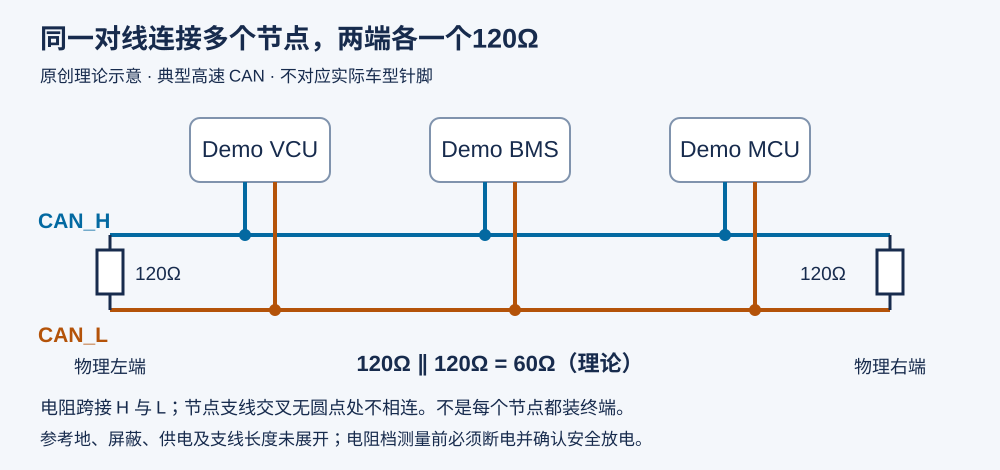
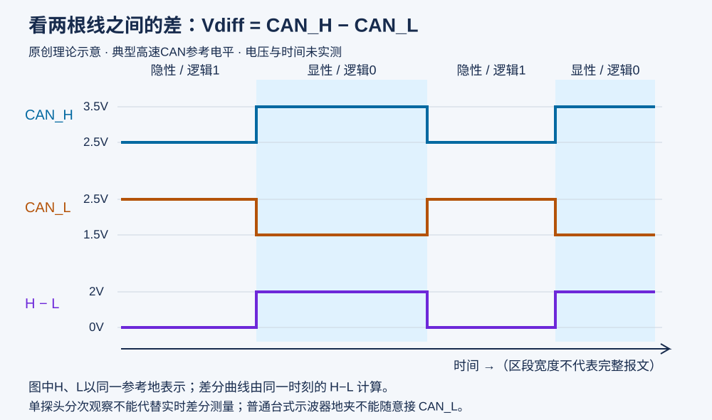

# 第06期 · CAN 总线基础、终端电阻与常用工具操作

第05期看模型里的 CAN 收发与信号连接，本期回到模型外面：两根 CAN 线怎样连接，终端电阻为什么常见为两个 120Ω，以及三个工具分别能看到什么。

配套文章：[CSDN：VCU入门实操——CAN总线基础、终端电阻与常用工具操作](https://blog.csdn.net/qian123456wang/article/details/170033630)。

文章讲基础与工具操作；这里提供可对照的原创图示、可手算的数据和逐项练习，避免重复整篇文章。**所有 CSV 均为人工构造，图片均为理论示意，未进行示波器、ZCANPRO、MeCa 或实车实测。**

## 先分清三个观察对象

| 工具 | 看什么 | 本期练什么 |
| --- | --- | --- |
| 示波器 | CAN_H、CAN_L 随时间变化的电压 | 探头倍率、时基、显性/隐性和单探头局限 |
| ZCANPRO | 时间、通道、ID、DLC、DATA 等报文字段 | 选设备与通道、接收记录、保存 ASC |
| MeCa | ECU 程序内部的测量变量 | 匹配 A2L、关联 Measurement、连接与同步 |

DBC 用于说明报文如何解释成信号；A2L 用于描述 ECU 内部测量和标定对象。把 DBC 导入报文工具，不等于已经读到了 ECU 内部变量。

## 1. 对着拓扑图找两端



图中三个节点都接同一对 CAN_H/CAN_L；电阻分别跨接两根线，放在总线物理两端。**不是每个节点都加一个电阻。** 节点与线束为虚构，未指定任何控制器针脚。参考地、屏蔽、供电和分支长度需按具体设备设计确认，图中没有给出完整接线方案。

断电并确认安全放电后，典型双终端网络的理论值：

`R = 1 / (1/120 + 1/120) = 60Ω`

额外并联 1.2kΩ 后约为 `57.14Ω`；多并联一个 120Ω 则变为 `40Ω`。这些算例说明负载变了，不能据此断言通信会改善，也不能只凭一次电阻读数判定故障。实际测量受网络结构和其他电路影响。

## 2. 对着波形图看电压差



| 状态 | 典型 CAN_H | 典型 CAN_L | 差分 H−L | 总线逻辑 |
| --- | --- | --- | --- | --- |
| 隐性 | 约2.5V | 约2.5V | 约0V | 1 |
| 显性 | 约3.5V | 约1.5V | 约2V | 0 |

这是典型高速 CAN 的简化参考值，不是所有设备的合格阈值，也没有画出完整 CAN 帧、边沿振铃或干扰。500kbit/s 的一个理论比特宽约2μs；250kbit/s 约4μs。

只有一支普通探头时，可按已经确认的安全接地方案分次观察 H 和 L；两次波形不能直接相减当作同一时刻的差分实测。台式示波器地夹往往接保护地，不能直接夹到 CAN_L 充当差分探头。实时差分测量需合适的差分探头，或经确认安全的双通道测量方案。

## 3. 使用虚构报文记录

打开 [can_frames.csv](examples/can_frames.csv)，先找 `channel`、`can_id`、`dlc`、`data_hex`。

本例只用经典 CAN 标准数据帧：ID `0x610` 和 `0x620`，每帧2字节。数据均为十六进制，字节从0开始计数；Byte0 是虚构计数，Byte1 固定为00，未定义车辆控制含义。

- `0x610` 的时间为0、20、40、80ms，间隔20、20、40ms。
- `0x620` 的时间为10、50、90ms，间隔40、40ms。
- 40ms 间隔只是一段虚构观察数据；没有协议周期和采集条件，不能直接判定丢帧。

**此 CSV 是自定义学习表，不是 ASC，不可直接当作 ZCANPRO 回放文件。**

## 4. 按顺序完成工具练习

1. [练习A](exercises/README.md#练习a终端电阻)：先算两个120Ω，再看多一个终端和额外1.2kΩ的区别。
2. [练习B](exercises/README.md#练习b示波器观察)：识别波形，写清倍率和时基，理解单探头局限。
3. [练习C](exercises/README.md#练习czcanpro接收与采集)：确认设备、通道和波特率，区分接收保存与主动发送。
4. [练习D](exercises/README.md#练习dmeca变量观察)：确认A2L匹配，添加测量变量并记录同步状态。

没有设备也可完成读图、计算和字段核对；实际操作保留为待验证。练习文档包含具体记录项和参考答案。

## 5. 运行离线检查脚本

Python 3.9及以上，无第三方依赖。从本期目录运行：

```bash
python tools/check_examples.py
```

Windows 也可使用 `py -3 tools/check_examples.py`。脚本按自身位置查找示例，与终端当前目录无关。

检查内容：CSV表头、标准/扩展帧ID范围、经典数据帧长度、十六进制字节、时间顺序、按通道和ID统计间隔，以及电阻并联计算。成功返回0，错误返回1。它不连接设备、不发送报文、不解析DBC，也不能判断真实总线是否健康。

预期摘要：7条虚构帧、2组ID、4个电阻算例。数据错误练习请修改副本，不覆盖原表。

## 文件导航与验证边界

| 文件 | 用途 |
| --- | --- |
| [拓扑 SVG](docs/can_topology.svg) | 双线、三个虚构节点、两端终端 |
| [差分 SVG](docs/can_differential.svg) | H、L和H−L三条理论曲线 |
| [报文 CSV](examples/can_frames.csv) | 7条虚构记录，练习字段和间隔 |
| [电阻 CSV](examples/termination_cases.csv) | 4个理论并联算例 |
| [练习与答案](exercises/README.md) | 电阻、示波器、ZCANPRO、MeCa |
| [离线脚本](tools/check_examples.py) | 只读检查本期两个 CSV |
| [验证记录](VALIDATION.md) | 已检查项、未实测项和记录表 |

基础参考：[TI CAN波形说明](https://www.ti.com/document-viewer/lit/html/SSZTCN3) · [maxon终端与拓扑说明](https://support.maxongroup.com/hc/en-us/articles/360009241840-CAN-bus-topology-and-bus-termination)。软件按钮以所用版本界面为准。

不使用公司协议、内部DBC、实车日志、内部模型、截图或付费课程资料，不把理论预期写成实测成果。

[返回CAN工具分类](../README.md) · [上一期](../../simulink/05-can-pack-unpack-routing/README.md) · [返回项目目录](../../README.md) · [返回首页](../../../README.md)
