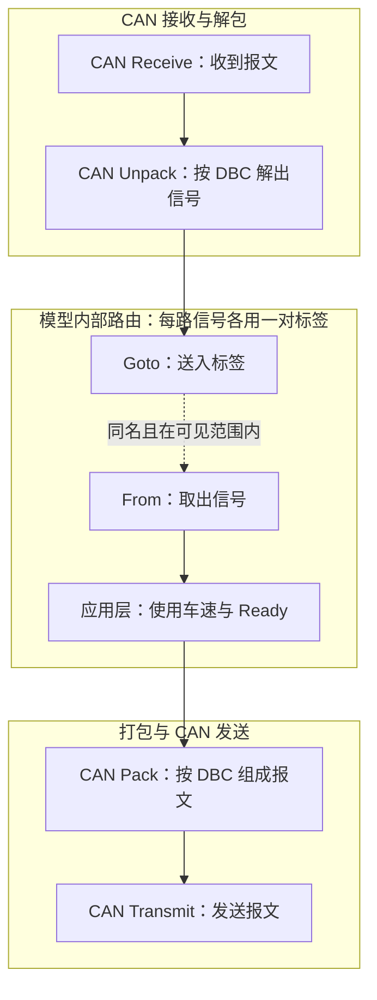

# 第05期 · 看懂 Simulink 中的 CAN 收发与信号连接

第04期练习了 Outport 的创建、命名和连线。本期继续看一条信号的来路和去处：**报文怎样变成车速，车速怎样在模型内部传到使用它的地方。**

本目录为独立设计的虚构教学示例，未进行 MATLAB/Simulink、CAN Pack/Unpack 或硬件实测。所有运行结果均为待验证的预期，详见 [验证记录](VALIDATION.md)。

## 先分清四个模块

| 模块 | 输入 → 输出 | 本例作用 |
| --- | --- | --- |
| CAN Unpack | CAN 报文 → 单独信号 | 按 DBC 解出车速和 Ready |
| Goto | 信号 → 标签入口 | 将车速送入 Demo_VehicleSpeed 标签 |
| From | 标签出口 → 信号 | 从同名且可见的 Goto 取出车速 |
| CAN Pack | 单独信号 → CAN 报文 | 按 DBC 把车速和 Ready 放回数据位 |

Goto/From 只负责模型内部信号路由，不选择 CAN 通道，也不代替 CAN 收发。CAN Pack 负责组成报文，实际发送还需要 CAN Transmit 等发送模块与相应配置。

## 信号流向

实线表示数据流，Goto 与 From 之间的虚线表示标签关联，不是 CAN 线。图中路由部分对车速和 Ready 分别成立；一个普通 Goto 不会自动把两路标量合并。收发部分是概念架构，未提供已运行的 CAN 模型。

本例只定义一条状态报文。离线练习可用它理解解包和重新打包；图中的发送不表示车辆需要转发收到的状态报文，也不表示已设计控制指令。

图源：[docs/signal_flow.mmd](docs/signal_flow.mmd)。

## 文件导航

| 文件 | 用途 |
| --- | --- |
| [dbc/demo_vcu_can.dbc](dbc/demo_vcu_can.dbc) | 1 条报文、2 个信号的虚构定义 |
| [examples/can_frames.csv](examples/can_frames.csv) | 3 组人工构造的原始数据与预期值 |
| [examples/signal_mapping.csv](examples/signal_mapping.csv) | 每组数据的起始位、位长、缩放与物理值对照 |
| [exercises/from_goto_practice.md](exercises/from_goto_practice.md) | 从空白模型搭建、改值、改错、检查 |
| [exercises/can_pack_unpack_checklist.md](exercises/can_pack_unpack_checklist.md) | Pack/Unpack 配置与离线核对清单 |
| [scripts/Check_FromGoto_OrphanTags.m](scripts/Check_FromGoto_OrphanTags.m) | 同名标签缺失与重复 Goto 的名称初筛 |
| [VALIDATION.md](VALIDATION.md) | 已做检查、尚未验证事项与记录表 |

## 三组数据，先自己算

标准 CAN 帧：ID=0x321（十进制 801），报文名 DemoVehicleStatus，DLC=8。字节、位均从 0 开始编号，DATA 全部使用十六进制。

| 信号 | 起始位 | 长度 | 字节序 / 类型 | Factor | Offset | 单位 |
| --- | --- | --- | --- | --- | --- | --- |
| VehicleSpeed | 0 | 16 bit | Intel / 无符号 | 0.1 | 0 | km/h |
| Ready | 16 | 1 bit | Intel / 无符号 | 1 | 0 | 无；0=未就绪，1=就绪 |

车速占 Byte0、Byte1，低字节在前；Ready 占 Byte2 的 bit0。其他位不定义，三组示例中均置 0。Ready=1 仅为本例编码，不代表已满足真实车辆的行驶条件。

| 用例 | DATA（HEX，8 字节） | 车速原始值 | 车速物理值 | Ready |
| --- | --- | --- | --- | --- |
| Case1 | 00 00 00 00 00 00 00 00 | 0 | 0 km/h | 0 |
| Case2 | 7B 00 01 00 00 00 00 00 | 123 | 12.3 km/h | 1 |
| Case3 | C8 01 01 00 00 00 00 00 | 456 | 45.6 km/h | 1 |

手工核对：车速原始值 = Byte0 + 256 × Byte1；物理值 = 原始值 × Factor + Offset；Ready = Byte2 的最低位。

Case3：0xC8 + 256 × 0x01 = 200 + 256 = 456；456 × 0.1 = 45.6 km/h。CSV 是对照表，不是 ASC 日志，也没有自动回放功能。

注意：第02期也用了虚构 ID 0x321，但长度和信号定义不同。**本期必须单独使用本目录 DBC，不能混用前期定义。**

## 怎样使用

1. 先对照上表与两个 CSV，手算三组结果。
2. 按 [From/Goto 练习](exercises/from_goto_practice.md) 新建独立空白模型，用 Constant 模拟已解出的物理信号；只需 MATLAB 和 Simulink。
3. 需要时对该练习模型运行标签检查函数。它只读当前已加载模型，不修改连线。
4. 具备 Vehicle Network Toolbox 后，再按 [检查清单](exercises/can_pack_unpack_checklist.md) 配置 CAN Pack/Unpack；未安装时可先完成前两步。
5. 把实际使用版本、操作和结果补入 VALIDATION.md。仓库不提供虚假的 .slx 或未经验证的 DBC 自动加载脚本。

标签工具仅按名称初筛，不能保证 local、scoped、global 的实际可见性正确。重复名称只是候选问题，分属不同合法 local 作用域时可能允许；仍要更新模型并检查实际作用域。

## 与 CSDN 的关联

CSDN 第05期文章链接：**待补**。

同一期分工：文章讲四个模块的作用与读图思路；GitHub 提供可逐项核对的虚构 DBC、数据表、搭建练习和检查函数。文章发布后补真实链接。

参考：[MathWorks CAN Pack](https://www.mathworks.com/help/vnt/ug/canpack.html)、[CAN Unpack](https://www.mathworks.com/help/vnt/ug/canunpack.html)、[Goto](https://www.mathworks.com/help/simulink/slref/goto.html)、[From](https://www.mathworks.com/help/simulink/slref/from.html)。参数名称以所用版本界面为准；R2022b、R2024b 均未在本期实测。

[返回 Simulink 目录](../README.md) · [返回仓库首页](../../../README.md)
