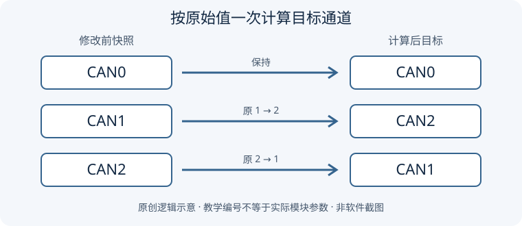

# 第08期 · Simulink CAN 通道批量修改

本期练习一个明确任务：**CAN0 保持不变，CAN1 与 CAN2 互换。** 第07期是 DaVinci 组件连接，本期回到 Simulink 参数修改。

配套文章：[CSDN 第08期：三种 CAN 通道修改方法](https://blog.csdn.net/qian123456wang/article/details/170195987)。文章讲操作思路；这里用原创数据、完整 MATLAB 映射脚本和检查表练习“先记录、再修改、后核对”，不照搬全文。

> 本目录没有真实 SLX 模型。脚本只计算表格中的通道映射，不打开、不修改模型，不连接 CAN 设备。所有模块与数据均为虚构教学设计；运行结果尚未在 MATLAB 中验证。

## 三种方法，怎样选？

| 方法 | 怎样做 | 适合什么情况 | 检查什么 |
| --- | --- | --- | --- |
| 1. 手动修改 | 在模块参数窗口逐个确认并修改通道 | 目标很少，先熟悉参数位置 | 逐项重新打开核对，避免漏改 |
| 2. MATLAB 批量修改 | 在命令窗口执行命令，或保存为脚本运行 | 目标较多，筛选规则与参数已经确认 | 模块清单、原值、目标值、重新读取的实际值 |
| 3. AI 辅助直接修改 | 清楚说明要求，提供有权处理的练习文件，让具备文件处理能力的 AI 修改并返回文件 | AI 环境能可靠处理该文件格式 | 核对返回文件和差异，再用本地软件打开验证 |

第二种方法中的“命令窗口”和“脚本”是两种执行形式，不再拆成两种方法。AI 若只能给代码，就还没有完成第三种方法；无法可靠处理 SLX 时应说明限制，不能声称已经改好。

## 第一步：写下修改规则



图是通道映射逻辑示意，不是 Simulink 截图。这里的 0、1、2 是教学编号，不保证等于任何硬件或模块掩膜的实际参数值。

| 修改前 | 修改后 | 规则 |
| --- | --- | --- |
| CAN0 | CAN0 | 保持 |
| CAN1 | CAN2 | 交换 |
| CAN2 | CAN1 | 交换 |

**先保存原值，再根据原值计算。** 如果先把所有 1 改成 2，再按已经改过的结果把所有 2 改成 1，原来的 CAN1 也会被改回 CAN1，交换就失败了。

不要只把模块名称里的 CAN1 改成 CAN2：名称与实际通道参数是两回事。也不要默认每个 Pack/Unpack、Goto/From 模块都有硬件通道选项；以实际收发模块、库类型和配置为准。

## 第二步：运行独立 MATLAB 示例

- [can_channel_mapping_demo.m](examples/can_channel_mapping_demo.m)：读取同目录 CSV，根据原始快照计算并打印前后对照表。
- [demo_module_inventory.csv](examples/demo_module_inventory.csv)：6 个虚构模块，CAN0、CAN1、CAN2 各两行，含预期目标列。

在具备适用 MATLAB 许可的环境中，把两个示例文件保留在同一文件夹。用 MATLAB 打开脚本，点击 Run；或者将 Current Folder 切到 examples，在命令窗口输入：

```matlab
can_channel_mapping_demo
```

脚本按自身位置找 CSV，不要求修改电脑上的绝对路径。仅用 MATLAB 表格与数组运算，此映射演示不需要 Simulink 或 CAN 硬件工具箱；未实测具体版本兼容性。

预期得到 6 行对照：原 CAN0 两行仍为 0，原 CAN1 两行变成 2，原 CAN2 两行变成 1；Changed 列有 4 个 true。脚本将计算值与 CSV 的 ChannelExpected 比较，不一致时报错。**这是运行预期，不是已执行日志。**

| 执行方式 | 通俗理解 | 注意 |
| --- | --- | --- |
| 命令窗口 | 临时输入并执行 | 粘贴片段时先执行读取原值的部分 |
| .m 脚本 | 保存完整步骤，方便复查与重复运行 | 保存后运行整个脚本，保留输入 CSV 原始值 |

重复运行本脚本会重新读取不变的 CSV，不会把上次结果再次交换；不要把它误当成可以反复执行的真实模型修改程序。

## 第三步：迁移到练习模型时

1. 先备份，另存副本；记录 MATLAB、Simulink、模块库和硬件支持包版本。
2. 手动打开一个目标模块，确认通道字段、实际参数名称与允许值，记录完整模块路径。不同库可能用数字、文字或设备标识表示通道，不能直接套本例 0/1/2。
3. 明确模型范围与目标模块类型；核对链接库、引用模型和变体中哪些对象应包含。先列清单、统计数量，不靠名称包含 CAN 就批量选中。
4. 对每个目标保留原通道，生成目标通道表。确认 CAN0 不变，再由适配该模块库的程序执行修改。本期不提供未经适配的通用 set_param 修改器。
5. 修改后重新读取模型参数，比较原值、目标值与实际值；保存并重新打开副本再次核对。
6. 按 [验证检查表](docs/verification-checklist.md) 检查 ID、DBC、连线和非目标模块，随后再安排模型更新、MIL/SIL 或硬件验证。

## 第四步：给 AI 的要求示例

> 只处理我提供的原创脱敏练习模型副本。先列出目标收发模块的完整路径和原始通道，确认参数实际表示方式；CAN0 不变，CAN1/CAN2 按原始快照互换。只改指定通道参数，保留报文 ID、DBC 引用、模块名称和连线。不要覆盖原文件。返回修改后的独立文件、逐模块前后差异及未验证事项。如果无法可靠读取或重写该格式，请停止并说明，不要生成虚假的修改结果。

AI 返回文件后仍要核对；“文件已修改”“参数复读一致”“模型可更新”“MIL/SIL 通过”是不同阶段。不能因为下载成功就认定模型可用。

## 小练习与答案

1. 原值为 0、2、1、2，目标应是什么？答案：0、1、2、1。
2. 先将 CAN1 改成 CAN2，再搜索全部 CAN2 改成 CAN1，为什么不行？答案：第二次搜索混入刚改过的对象，丢失原始分类。
3. 把 CSV 某行 ChannelExpected 故意填错，再运行会怎样？预期：显示计算值后，一致性断言报错。请修改副本，恢复后再练习。
4. CAN0 数量不变能证明没改错吗？不能，数量相同仍可能改错对象，必须逐模块比较。

## 文件与验证状态

[验证记录](VALIDATION.md) 区分静态检查与未执行的软件验证。本期无公司模型、内部 DBC、日志、付费课程原件或商业截图，不附带软件安装包或许可证。

[返回 Simulink 分类](../README.md) · [项目总目录](../../README.md) · [仓库首页](../../../README.md)
