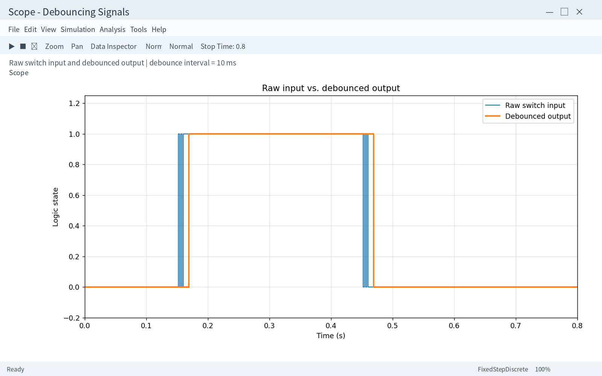
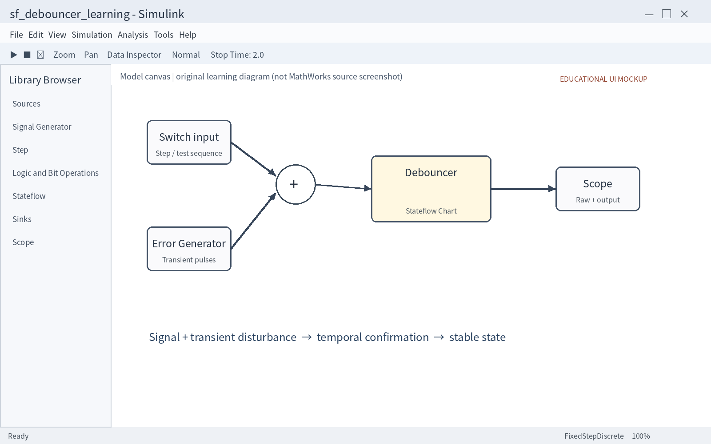
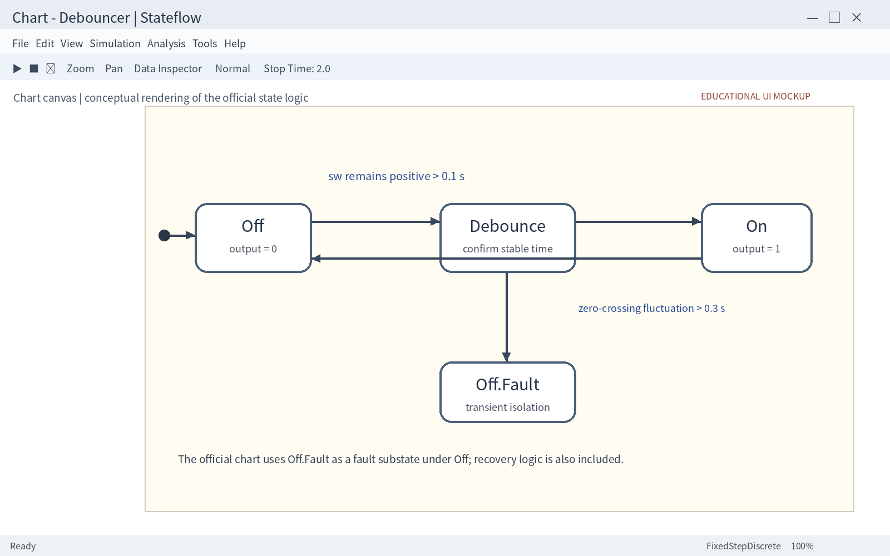
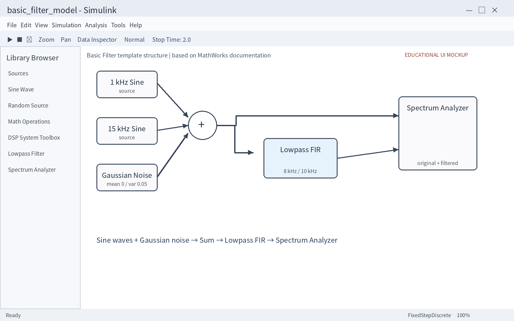
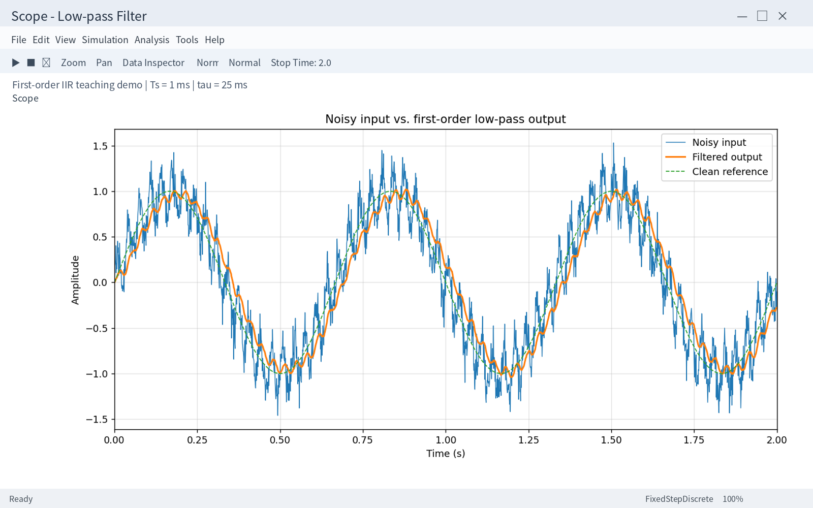

# 第12期 · 汽车电子：Simulink 消抖与滤波对比实战

本项目配套 CSDN 第12期正式文章：[汽车电子：Simulink 实战——消抖和滤波到底有什么区别，什么时候该用哪个？](https://blog.csdn.net/qian123456wang/article/details/171094467?spm=1001.2014.3001.5501)。

CSDN 讲概念、官方示例和工程判断；GitHub 提供两组独立、可运行的 MATLAB 教学实验、回归测试、输入输出数据和仿真界面风格配图。这里不复制 MathWorks 官方模型，也不把两种处理方法混成一个算法。

> 所有参数和波形均为原创教学模拟数据，不是实车标定、实车采集或企业项目数据。预置软件界面图为工程软件风格教学示意，不是真实 MATLAB/Simulink 运行截图。

## 1. 本期解决什么问题？

两类信号“不稳定”，要处理的目标不同：

- **消抖 Debouncing**：针对开关/状态输入短时间内反复跳变，确认新状态是否连续保持到规定时间，再更新输出。
- **滤波 Filtering**：针对连续数值信号中的某些噪声成分，按滤波器频率响应削弱不需要的波动；滤波会改变动态响应，可能引入延迟。

“消抖用于开关量、滤波用于连续量”是入门时有用的典型区分，不是绝对边界。数字滤波也可处理离散采样信号；传感器阈值状态可能需要滞回/时间确认；CAN报文超时应由超时监测处理，不能用低通滤波代替。

## 2. 项目内容

| 路径 | 内容 |
| --- | --- |
| `matlab/demo_parameters.m` | 所有原创教学参数 |
| `matlab/run_debounce_demo.m` | 基于连续稳定采样数的开关消抖示例 |
| `matlab/run_filter_demo.m` | 一阶离散低通 IIR 示例，精确指数系数 |
| `matlab/run_all_demos.m` | 运行两组实验并导出 CSV |
| `matlab/plot_results.m` | 绘制消抖与滤波波形 |
| `tests/run_tests.m` | 10项 MATLAB 断言，待在 MATLAB 中执行 |
| `tools/check_reference.py` | 纯 Python 标准库独立参考检查，不执行 MATLAB |
| `examples/` | 预期结果、独立参考 CSV 和 Python 检查记录 |
| `figures/` | 5张工程软件风格教学示意图 |
| `exercises/README.md` | 参数修改、故障/边界思考和官方模型操作练习 |
| `VALIDATION.md` | 验证证据与未完成事项 |

## 3. 图01：消抖 Scope 波形

黄色/蓝色等曲线展示原始开关输入与消抖输出。输入在 0.150 s 和 0.450 s 附近加入短时触点跳变；输出只在输入连续稳定达到 10 ms 后切换。



## 4. 图02：原创 Simulink 风格消抖结构

输入信号与瞬态干扰叠加后，进入 Debouncer 逻辑，再观察稳定输出。图为教学模型结构示意，不是官方 `sf_debouncer` 模型截图。



## 5. 图03：Stateflow 消抖状态逻辑

官方示例的核心状态和时间条件可在 Stateflow Chart 中观察。这里的界面是帮助理解状态关系的原创示意，不是 MathWorks 原图。



## 6. 图04：官方 Basic Filter 模型结构参考

MathWorks 官方 Simulink 示例使用两个 Sine Wave、Gaussian Noise、求和、Lowpass FIR Filter 和 Spectrum Analyzer。此处为按官方文字说明绘制的教学结构图。



## 7. 图05：低通滤波 Scope 波形

原创一阶低通教学实验将 1.5 Hz 有用信号与 30 Hz 干扰、随机噪声叠加，再用一阶离散低通处理。输出会更平滑，但相位/响应也会改变。



## 8. 两组实验分别是什么？

### A. 消抖：基于连续稳定样本数

- 采样时间：1 ms。
- 确认时间：10 ms。
- 开关有效状态：0.150 s ON，0.450 s OFF。
- 在两次变化边沿附近模拟 10 ms 触点跳变。
- 输出只有在候选状态连续满足 10 个样本后才切换。

这是一个便于阅读的基础 MATLAB 教学实现。它不是 MathWorks 官方 Stateflow Chart 的源码，也不是量产控制策略。

### B. 滤波：一阶离散低通 IIR

- 采样时间：1 ms。
- 时间常数：25 ms。
- 有用信号：1.5 Hz。
- 额外高频成分：30 Hz。
- 高斯噪声标准差：0.12。
- 离散系数：`a = exp(-Ts/tau)`。
- 差分方程：`y[k] = a*y[k-1] + (1-a)*u[k]`。

这里的 IIR 是本项目为基础 MATLAB 可运行性设计的独立教学例子。**MathWorks 官方 Basic Filter 模型是 Lowpass FIR Filter（FIR），两者不是同一个模型或算法。**

## 9. 在 MATLAB 中运行

建议使用 MATLAB R2022b 或更新版本。两个自制实验只使用基础 MATLAB 语法，不依赖 Simulink 或 DSP System Toolbox。

在 MATLAB 当前文件夹切换到本期项目根目录，运行：

```matlab
addpath('matlab','examples','tests');

p = demo_parameters();
d = run_debounce_demo(p);
f = run_filter_demo(p);

d.Summary
f.Summary

results = run_all_demos(false);
report = run_tests();
```

需要绘图和导出图片时：

```matlab
results = run_all_demos(true);
```

CSV 与绘图文件会生成在 `outputs/`，不会覆盖仓库中的预置示意图。

## 10. 官方模型怎么打开？

### 官方消抖模型：Stateflow

MathWorks 文档：  
[Reduce Transient Signals by Using Debouncing Logic](https://www.mathworks.com/help/stateflow/ug/debouncing-signals.html)

官方页面介绍两种方式：

1. `duration` 时间运算符：`Off` 与 `On` 两状态；输入 `sw` 连续非负超过 0.01 s 才进入 On，连续为负超过 0.01 s 才回到 Off。
2. 中间状态和故障检测：使用 `Off`、`Debounce`、`On`，在反复过零超过 0.3 s 时进入 `Off.Fault`；官方示例还包含恢复逻辑。

官方页面点击 **Open Model**，再打开 `Scope` 和 `Debouncer` Chart 运行观察。`duration` 仅支持 Simulink 模型中的 Stateflow Chart。示例模型名为 `sf_debouncer`。

### 官方低通滤波模型：Simulink Basic Filter

MathWorks 文档：  
[Filter Frames of a Noisy Sine Wave Signal in Simulink](https://www.mathworks.com/help/dsp/ug/filter-frames-of-a-noisy-sine-wave-signal-in-simulink.html)

官方页面说明可从 MATLAB Home > Simulink > **Basic Filter** 模板创建模型。结构包括两个正弦波（1 kHz、15 kHz）、Gaussian Noise（均值0、方差0.05）、Sum、Lowpass FIR Filter 和 Spectrum Analyzer；采样率 44.1 kHz，通带 8 kHz、阻带 10 kHz，通带纹波 0.1 dB，阻带衰减 80 dB。需要 Simulink 和 DSP System Toolbox。

官方示例模型可用时运行：

```matlab
open_system('basic_filter_model.slx');
set_param('basic_filter_model','StopTime','256/44100 * 400');
sim('basic_filter_model.slx');
```

注意：如果本地没有该文件，先通过官方页面的 **Open Model** 或 Basic Filter 模板创建；不要把本项目的一阶 IIR 脚本误认为官方 FIR 模型。

## 11. 验证状态

- Python 独立参考检查：已执行；检查消抖边沿时间、短时抖动抑制和低通残差衰减。
- MATLAB 代码：已编写并静态审阅；尚未在 MATLAB 中执行。
- `tests/run_tests.m`：10项断言已编写；尚未运行。
- Simulink/Stateflow 官方模型：提供官方链接和打开步骤；尚未在本环境运行。
- 实车、台架、MIL/SIL/HIL：未涉及。

详细记录见 [VALIDATION.md](VALIDATION.md)。

## 12. 工程应用判断

| 输入/问题 | 首先考虑 | 还要注意 |
| --- | --- | --- |
| 机械开关触点短时反复跳变 | 消抖 | 确认时间必须小于允许的最大响应延迟 |
| 转速/电流等连续测量值带高频噪声 | 数字滤波 | 选择截止频率和采样率，评估相位/延迟 |
| 温度等数值经过阈值后在边界反复切换 | 滞回或持续时间确认；必要时先滤波 | 不要只凭“信号抖”就盲目选模块 |
| CAN 报文停止更新 | 通信超时监测 | 滤波不能替代报文新鲜度/超时诊断 |

## 13. 参考资料

- [MathWorks：Reduce Transient Signals by Using Debouncing Logic](https://www.mathworks.com/help/stateflow/ug/debouncing-signals.html)
- [MathWorks：Filter Frames of a Noisy Sine Wave Signal in Simulink](https://www.mathworks.com/help/dsp/ug/filter-frames-of-a-noisy-sine-wave-signal-in-simulink.html)
- [MathWorks：Digital Filter Implementations](https://www.mathworks.com/help/dsp/ug/digital-filter-block.html)

[返回 Simulink 项目目录](../README.md) · [返回仓库首页](../../../README.md)
