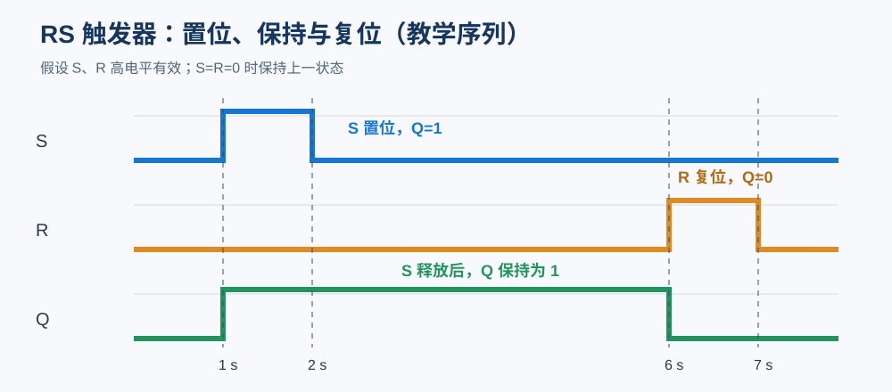
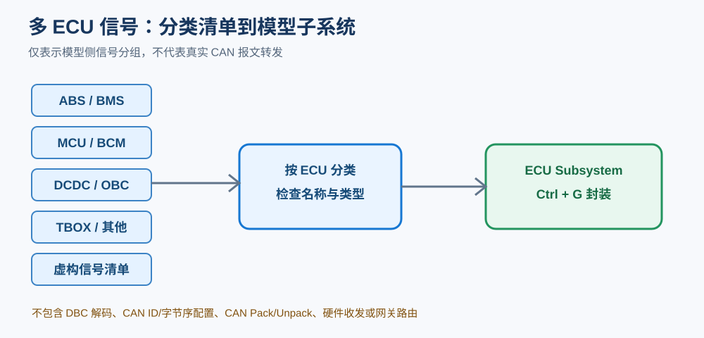

# 第13期 · Simulink：RS触发器与多 ECU 信号整理

配套 CSDN：[Simulink 模型开发实战：RS触发器与多 ECU CAN 信号转发](https://blog.csdn.net/qian123456wang/article/details/171372527)。

本期分为两个独立知识点：RS 状态保持；多 ECU 信号分类、数据类型转换和子系统组织。CSDN 讲解原理与界面操作，GitHub 提供参考逻辑、虚构信号清单和练习步骤。

> 所有信号名、数值及时序均为原创教学数据，不来自企业协议、客户项目、实车采集或量产标定。此处的“CAN 子系统”仅是模型组织层级，不表示真实 CAN 报文解析或总线转发。

## 1. RS：置位、保持、复位

本练习假设 S、R 均为高电平有效：

| S | R | Q |
|---:|---:|---|
| 0 | 0 | 保持上一状态 |
| 1 | 0 | 置位为 1 |
| 0 | 1 | 复位为 0 |
| 1 | 1 | 本参考程序判为无效输入并报错 |

默认时序：S 在 1～2 s 置位，R 在 6～7 s 复位。重点观察 S 释放后 Q 仍保持，以及 R 触发后 Q 清零。

**注意：** 同时有效时的行为必须以当前 Simulink 版本中 RSFlipFlop 模块帮助和实际配置为准。本练习的报错规则只是独立参考逻辑，不代表所有 Simulink 模块的默认行为。



## 2. Data Type Conversion

练习比较 double 转 single、double 转 uint8 的输出类型和值。重点关注目标类型、整数取整方式及超出目标范围时的处理。MATLAB 类型转换示例不等于覆盖 Simulink 模块的所有参数组合。

## 3. 多 ECU 信号分类与子系统

`data/ecu_signal_catalog.csv` 包含 11 条虚构信号，来自 ABS、BMS、MCU、BCM、DCDC、OBC、TBOX 七个 ECU。程序检查信号名唯一性、数据类型并按 ECU 统计。



本项目不包含 DBC 解析、CAN ID/字节序/起始位解析、CAN Pack/Unpack、硬件收发或网关路由。模型中的子系统封装不等于实际 CAN 总线报文转发。

## 4. 文件结构

- `matlab/rs_flipflop_step.m`：单步 RS 参考逻辑。
- `matlab/rs_flipflop_demo.m`：生成 RS 输入输出时序。
- `matlab/data_type_conversion_demo.m`：类型转换示例。
- `matlab/organize_ecu_signals.m`：读取 CSV 并按 ECU 分组。
- `matlab/run_all_demos.m`：运行练习并导出结果。
- `data/ecu_signal_catalog.csv`：虚构 ECU 信号清单。
- `tests/run_tests.m`：MATLAB 断言，待本机执行。
- `tools/check_reference.py`：Python 独立参考检查，不执行 MATLAB。
- `examples/`：参考结果。
- `figures/`：SVG 矢量示意图。
- `exercises/README.md`：Simulink 手动搭建步骤。
- `VALIDATION.md`：验证记录与边界。

## 5. MATLAB 运行

在 MATLAB 当前文件夹切换到本项目根目录，然后运行：

```matlab
addpath('matlab','tests');
results = run_all_demos();
report = run_tests();
```

结果 CSV 输出到 `outputs/`。基础脚本使用 MATLAB 表格、数值与文件读写功能；不要求 Simulink。MATLAB 代码和断言尚未在本次准备环境中执行，须由本机实际运行确认。

## 6. Simulink 动手步骤

按 [exercises/README.md](exercises/README.md) 操作。Scope 用于看随时间变化的波形，Display 用于看当前数值。没有附未经生成、打开和运行验证的 .slx 文件。

## 7. Python 参考检查

```bash
python tools/check_reference.py
```

该脚本只检查独立参考逻辑和教学数据，不执行 MATLAB/Simulink。

[返回 Simulink 项目目录](../README.md) · [返回仓库首页](../../../README.md)
