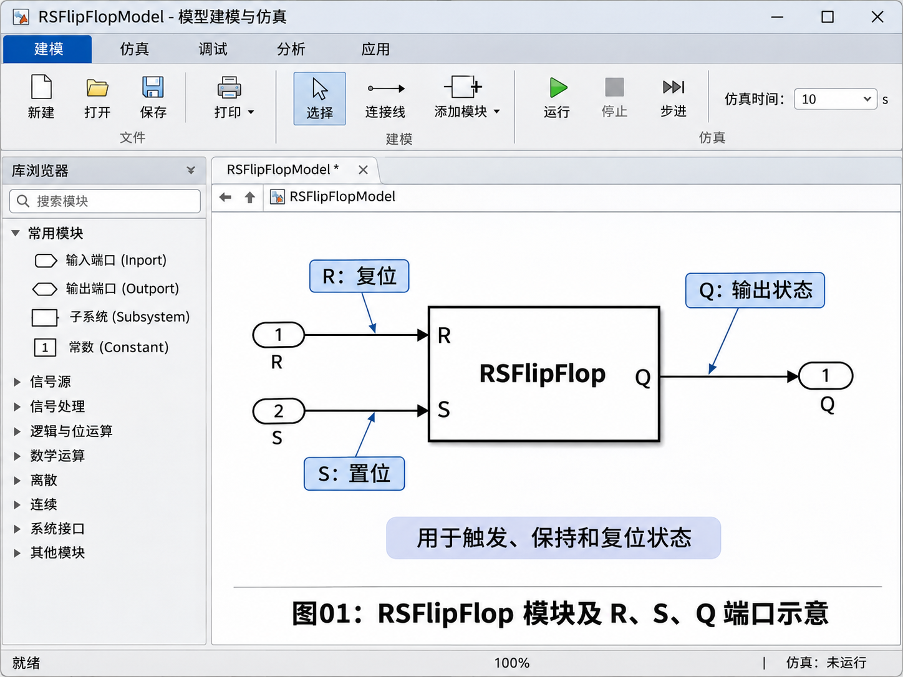
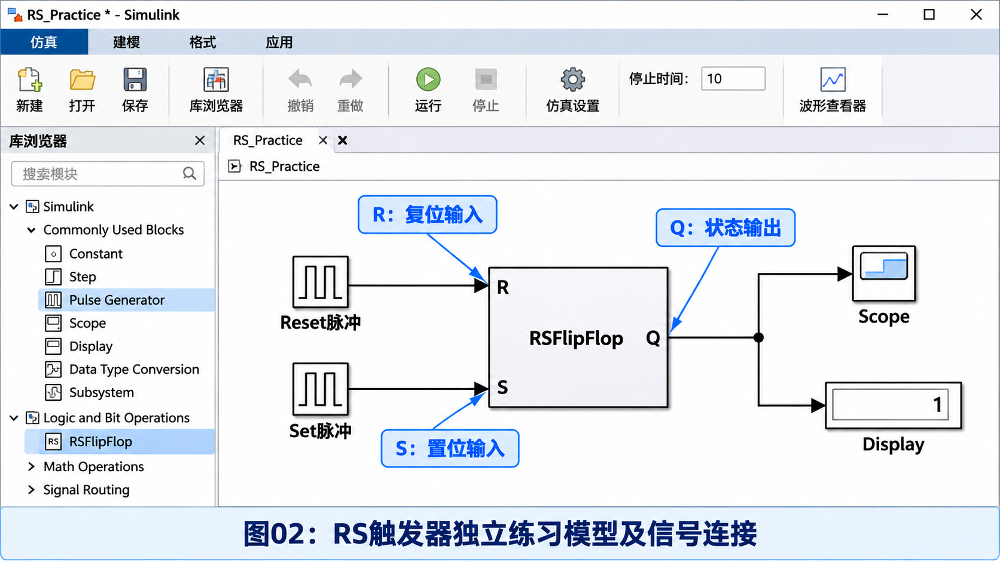
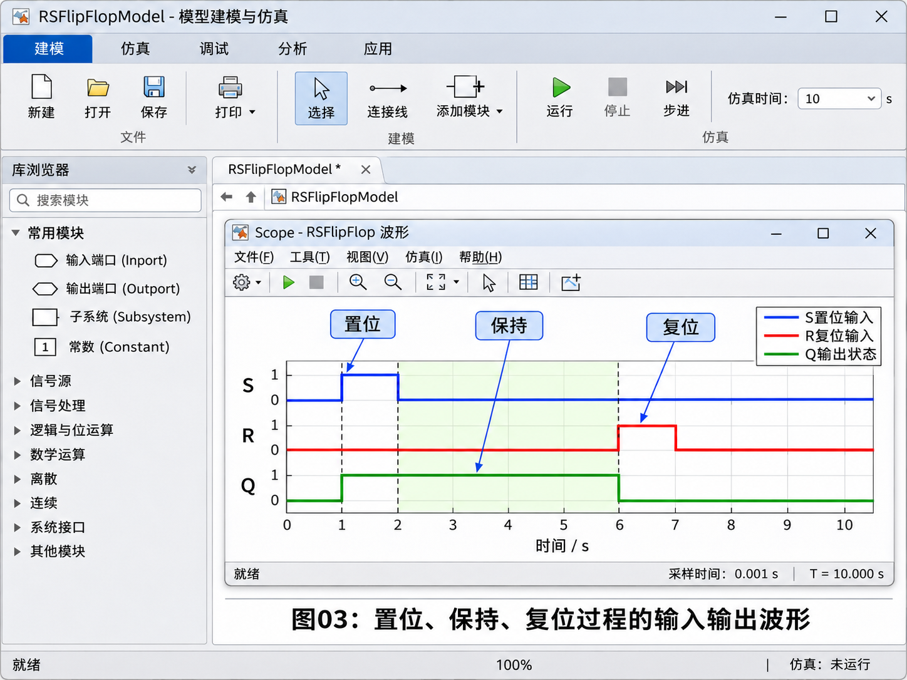
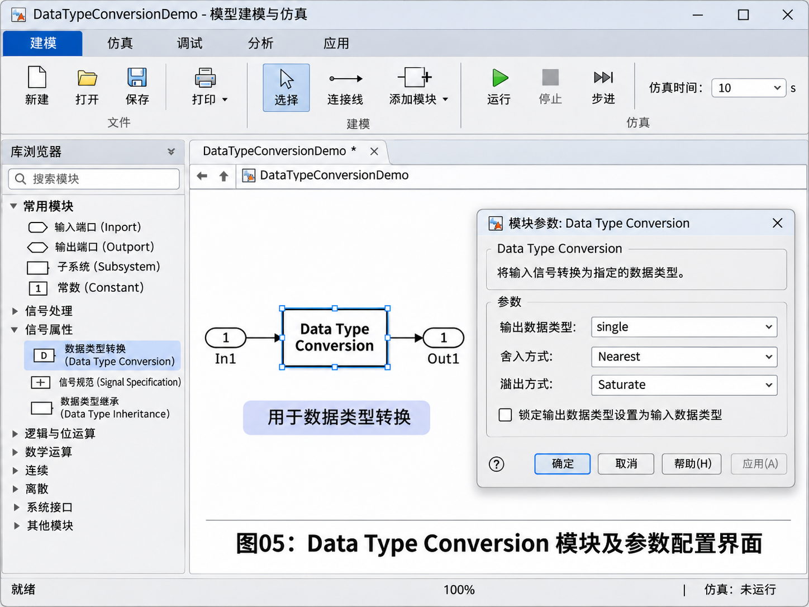
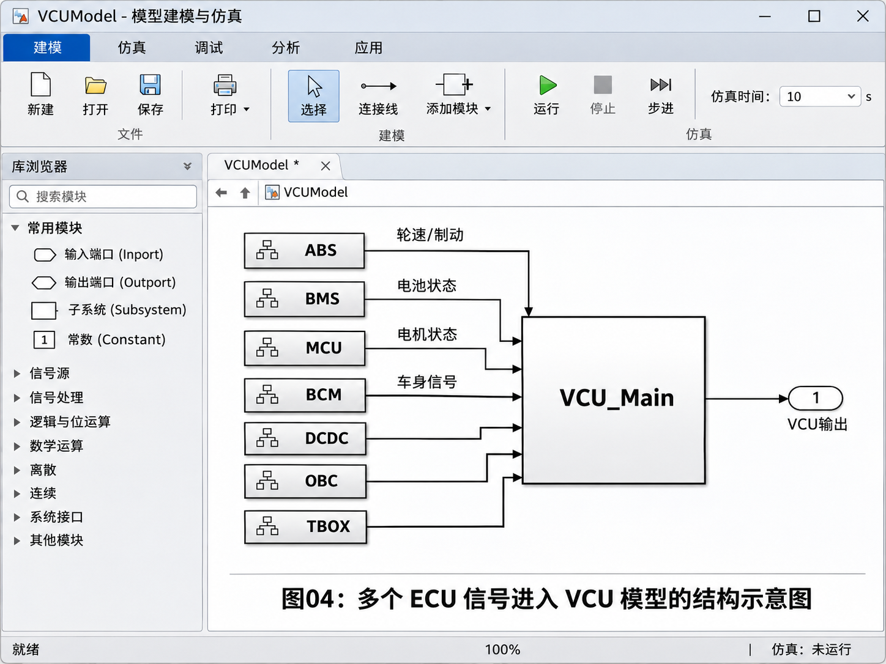
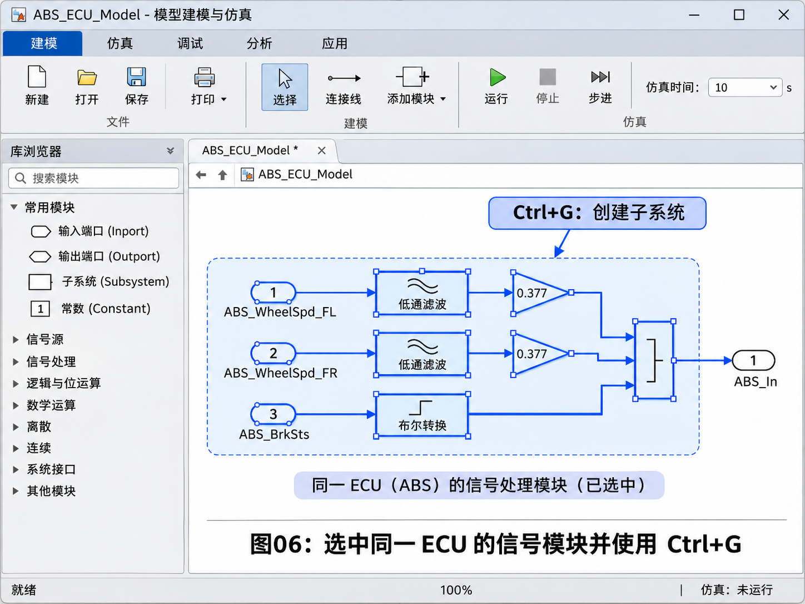
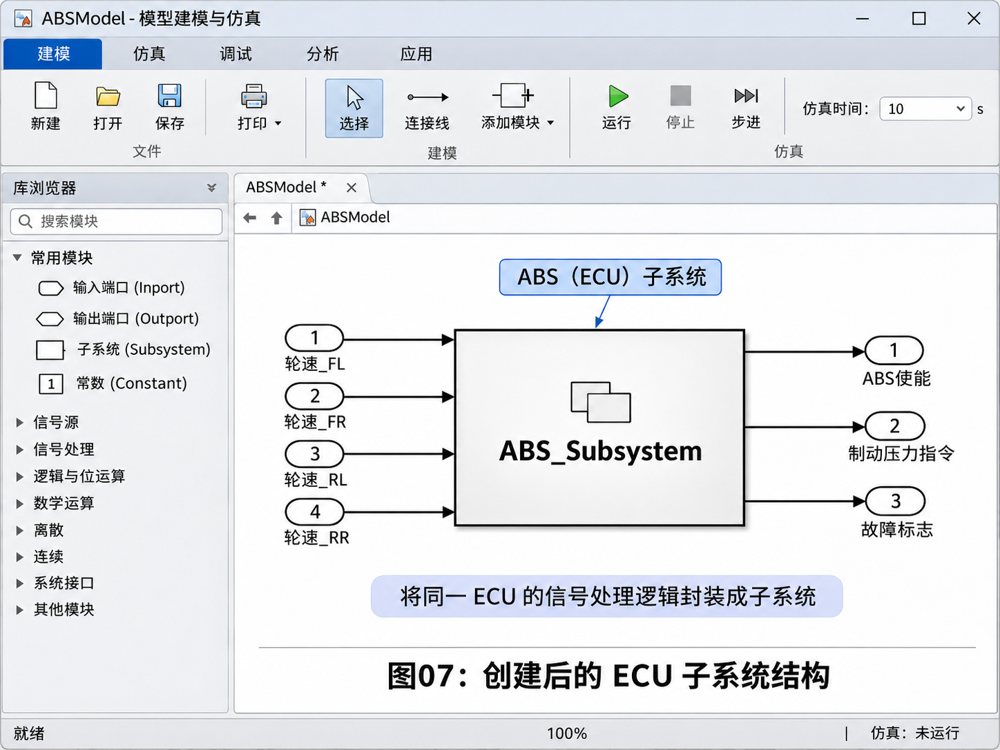
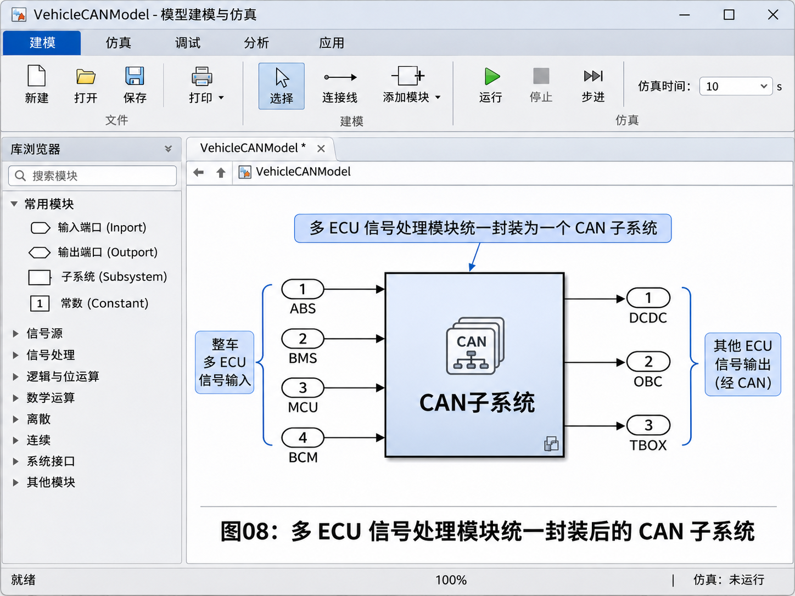

# 第13期 · Simulink 模型开发：RS触发器与多 ECU 信号整理

配套 CSDN 正式文章：[Simulink 模型开发实战：RS触发器与多 ECU CAN 信号转发](https://blog.csdn.net/qian123456wang/article/details/171372527)。

CSDN 负责概念和操作讲解；GitHub 提供独立 MATLAB 教学参考、虚构 ECU 信号清单、练习步骤和验证记录。两边互补，不复制正文。

> 所有信号名称、数值和时序均为原创教学模拟内容，不来自企业协议、客户项目、实车采集或量产标定。“CAN 子系统”仅表示模型侧信号分类与组织，不代表 CAN 报文解码、网关路由或真实总线转发。

**配图说明：**【图01】～【图08】均为 AI 辅助制作的原创教学示意图，采用软件界面风格，**不是 MATLAB/Simulink 实际运行截图或测试证据**。图中的菜单、库位置、端口和状态栏用于说明概念，具体操作以本机版本与[练习步骤](exercises/README.md)为准。

## 本期练习

### 1. RS 触发器：置位、保持、复位

采用高电平有效的独立教学参考逻辑：S=1、R=0 时置位；S=0、R=1 时复位；S=0、R=0 时保持上一状态。S/R 同时有效时，本练习明确报错，不自行假设 Simulink 模块优先级。真实模块行为应以本机版本帮助和实测为准。

默认时序：S 在 1～2 s 置位，R 在 6～7 s 复位；采样间隔 0.1 s，仿真区间 0～10 s。

【图01】R、S、Q 的含义（原创教学示意）。实际官方模块名为 `S-R Flip-Flop`，可能还带有反相输出 `!Q`；按端口标识连接，不按图中上下位置猜测。



【图02】独立练习连接（原创教学示意）。Scope 观察随时间变化的波形，Display 显示当前数值；图中的 Display=1 只表示置位后的某一时刻，10 s 结束时本练习预期为 0。



【图03】置位、保持、复位的预期波形（原创教学示意，非实测）。1 s 时 Q 置位，2 s 后保持，6 s 时复位；图内状态栏的采样时间文字不是脚本配置，脚本与手动练习统一使用 0.1 s。



### 2. Data Type Conversion

练习 double、single、uint8 类型差异，关注取整方式、目标类型范围和溢出处理。MATLAB 类型转换示例不等于覆盖所有 Simulink 模块参数组合。

【图05】类型转换参数概念（原创教学示意）。`single` 仍是浮点数，不会因为图中出现整数舍入选项就变成整数；整数舍入和饱和练习在目标类型改为 `uint8` 后进行。



`data_type_conversion_demo.m` 使用 MATLAB 的 `uint8(...)`：本例输入 `[-1.2,0,12.4,12.6,254.7,260]` 的预期整数结果为 `[0,0,12,13,255,255]`。这是待 MATLAB 执行核对的预期值，不是运行记录。

### 3. 多 ECU 信号分类与子系统组织

使用虚构信号清单，按 ABS、BMS、MCU、BCM、DCDC、OBC、TBOX 分类。练习将同一 ECU 的相关模块封装为 Subsystem，再放入上层 CAN 子系统。

本练习不包含 DBC 解析、CAN ID/字节序/起始位解析、CAN Pack/Unpack、硬件收发或网关白名单配置。

【图04】按来源 ECU 整理模型信号（原创教学示意）。CSV 共 11 路输入，分组数为 ABS=3、BMS=2、MCU=2，其余四组各 1 路；图中连线只表达分组关系。



【图06】选中同一 ECU 的模块后创建 Subsystem（原创教学示意）。只学习选区与封装；图内滤波和增益 `0.377` 不属于本期 CSV 的换算定义，不应复制到练习信号链。



【图07】封装后可在上层查看端口（独立结构示意，不是图06按 Ctrl+G 后的逐端口结果）。图内四轮输入与控制输出不在本期 CSV 中；本期不实现 ABS 控制算法。实际练习沿用 CSV 的 3 路 ABS 输入与对应 3 路透传输出，封装前后数量、名称和连线应保持一致。



【图08】上层 CAN 子系统的命名与封装（原创教学示意）。图右侧“经 CAN”不表示本项目已经发送报文，也不定义 ABS/BMS 到 DCDC/OBC/TBOX 的转发映射。CSV 中七类 ECU 全部是模型输入的来源；练习仅按原对应关系透传 11 路信号。



## 文件结构

- matlab/：RS 状态参考、类型转换、ECU 分组和运行入口。
- data/：原创虚构 ECU 信号清单。
- tests/：MATLAB 断言，待用户本机执行。
- tools/：独立 Python 参考检查。
- exercises/：Simulink 手动搭建步骤。
- figures/：八张独立 PNG 原创教学示意图（编号保留 CSDN 图位编号，按对应主题插入）。
- VALIDATION.md：验证边界和未完成事项。

## MATLAB 运行

在 MATLAB 当前文件夹切换到本期项目根目录，在命令窗口执行：

    addpath('matlab','tests');
    results = run_all_demos();
    report = run_tests();

结果 CSV 写入 outputs/。脚本使用基础 MATLAB，不要求 Simulink；Simulink 手动搭建步骤见 exercises/README.md。

`run_tests.m` 含 13 项断言，**尚未在 MATLAB 执行**。`organize_ecu_signals.m` 只读取 CSV 并输出分组元数据，不会自动创建 Subsystem 或更改模型。

在终端进入本期根目录后，可运行独立参考检查：

```bash
python3 tools/check_reference.py
```

它检查 Python 参考时序和 CSV，不执行 `.m` 文件。当前验证范围见 [VALIDATION.md](VALIDATION.md)。

## 与 CSDN 的分工

- CSDN：RS 触发器端口、置位保持复位、数据类型转换、ECU 分类和 Ctrl+G 子系统操作。
- GitHub：可运行的基础 MATLAB 参考逻辑、虚构信号清单、测试和操作练习。

[返回 Simulink 项目目录](../README.md) · [返回仓库首页](../../../README.md)
