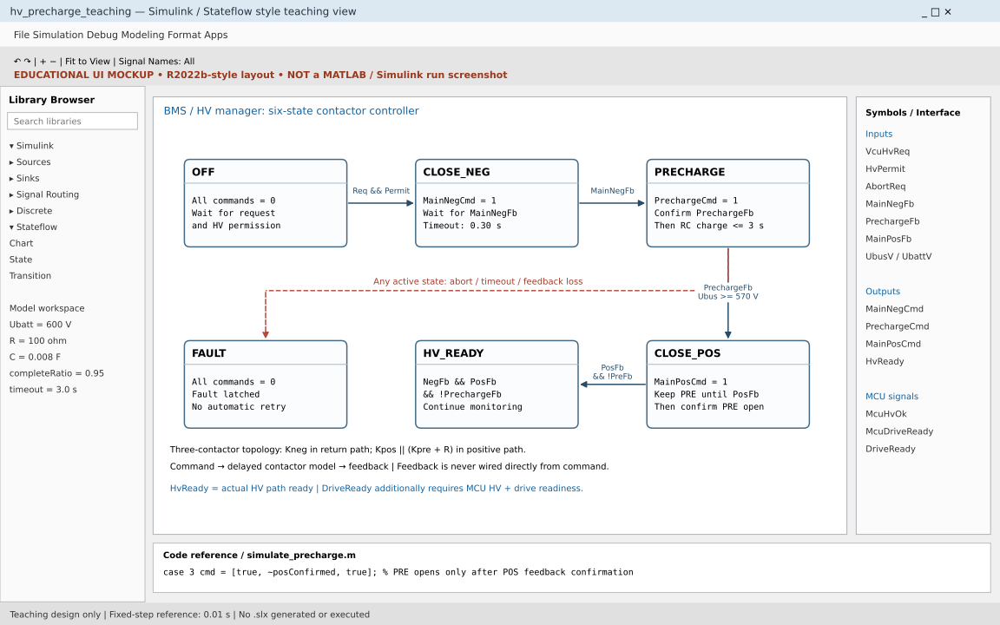
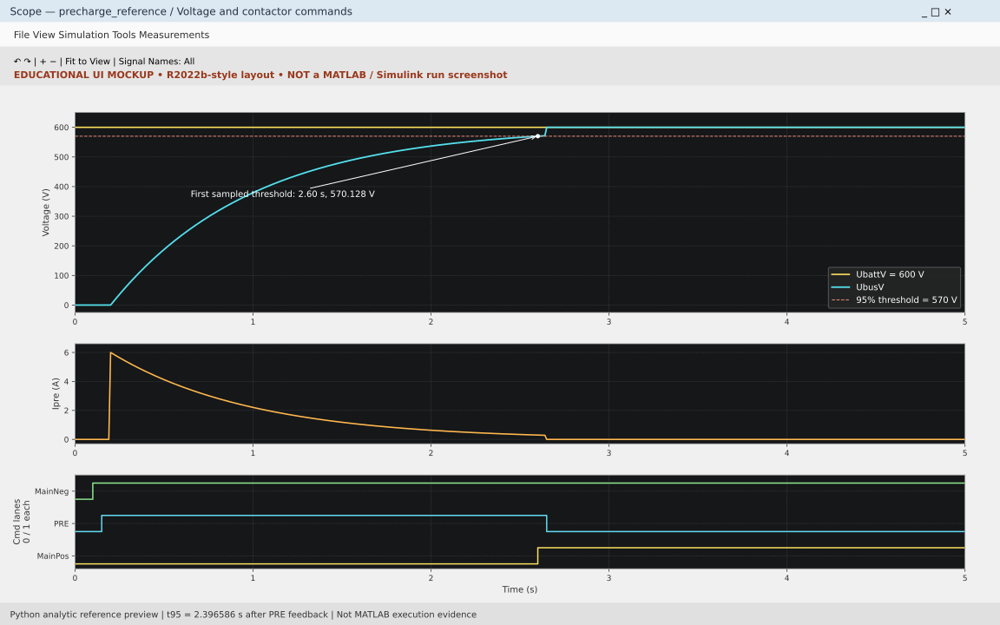
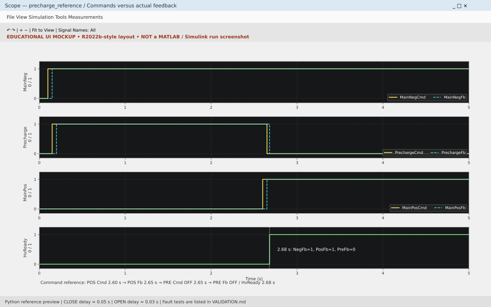

# 第11期 · VCU 高压上电与预充控制——MATLAB 离线仿真及故障测试

[CSDN 第11期：VCU 高压上电控制——从上电请求、预充到主继电器闭合](https://blog.csdn.net/qian123456wang/article/details/171017310)

CSDN 讲原理和操作；本项目提供独立参数、基础 MATLAB 参考仿真、命令与反馈日志、故障断言和练习。目标是能检查“哪一拍发命令，哪一拍收到反馈，哪一拍允许进入下一状态”。

**验证边界：5个 `.m` 文件已通过 MISS_HIT 静态检查，Python 独立数学参考的14组检查通过；MATLAB、Simulink、Stateflow 均未实际运行。** 预置图片采用SVG格式，是工程软件风格的教学界面示意，不是真实运行截图；本目录没有 `.slx`。详情见 [VALIDATION.md](VALIDATION.md)。

## 1. 从哪里开始

| 文件 | 用途 |
| --- | --- |
| [examples/demo_parameters.m](examples/demo_parameters.m) | 本期独立设计的电压、RC、采样周期、延时与超时参数 |
| [matlab/simulate_precharge.m](matlab/simulate_precharge.m) | 六状态控制器、延迟接触器模型、RC母线及12种场景 |
| [matlab/run_all_examples.m](matlab/run_all_examples.m) | 生成12组完整 CSV 和汇总；可选绘图 |
| [matlab/plot_precharge_results.m](matlab/plot_precharge_results.m) | 用本地 MATLAB 输出画电压、电流、状态及命令/反馈曲线 |
| [tests/run_tests.m](tests/run_tests.m) | 12个场景＋反馈截止时刻＋无效参数，共14组 MATLAB 断言，尚未执行 |
| [examples/expected_results.txt](examples/expected_results.txt) | 公式和时序参考值，不是 MATLAB 日志 |
| [examples/python_reference_summary.csv](examples/python_reference_summary.csv) | Python 独立参考的12个场景汇总 |
| [examples/python_reference_normal.csv](examples/python_reference_normal.csv) | 501个采样点的正常流程参考数据，列名与 MATLAB 日志一致 |
| [examples/python_reference_check.txt](examples/python_reference_check.txt) | 本次实际执行的 Python 参考检查记录 |
| [tools/check_reference.py](tools/check_reference.py) | 按解析RC公式及事件时刻独立生成参考，不执行 `.m` |
| [tools/render_figures.py](tools/render_figures.py) | 从参考CSV重绘图01～03的SVG与PNG；可选维护工具，需要 matplotlib/Pillow |
| [exercises/README.md](exercises/README.md) | 改电容、改延时、故障注入与 Stateflow 搭建练习 |

## 2. 本教学架构中的职责

| 控制器/模块 | 在本实验中负责什么 | 本实验如何表示 |
| --- | --- | --- |
| VCU | 提出整车高压请求、仲裁允许条件、接收高压状态 | `VcuHvReq`、`HvPermit`、`AbortReq` 与 `HvReady`；不直接驱动三个线圈 |
| BMS／高压管理控制器 | 执行接触器顺序、监测电压和反馈、处理超时 | `simulate_precharge` 中的六状态逻辑，输出三个 `Cmd` |
| 接触器及高压回路 | 命令发出后延迟动作，返回独立反馈；电阻给电容充电 | `contactor_step`、RC更新和故障注入 |
| MCU | 提供自身高压与驱动准备状态 | `McuHvOk`、`McuDriveReady`；与高压完成共同得到 `DriveReady` |

这是便于练习的一种职责划分。其他架构可以由 VCU、BMS 或独立高压管理器承担不同部分；不能把本例当作所有车辆的固定分工。

`HvReady` 只表示本例的高压路径满足条件。`DriveReady = HvReady && McuHvOk && McuDriveReady` 仍是简化的驱动准备示例，未包含真实整车挡位、制动和扭矩许可仲裁。

## 3. 三接触器拓扑与状态顺序

采用常见拓扑：主负 `Kneg` 位于电池负极回路；电池正极到母线正极有两条并联路径，一条为主正 `Kpos`，另一条为 `Kpre + R`。母线两端连接等效电容 `C`。因此主负未闭合时，预充支路不能形成有效回路。

| 状态（StateCode） | 命令与离开条件 |
| --- | --- |
| OFF（0） | 三个命令均为0；请求、许可有效且无中止时进入 CLOSE_NEG |
| CLOSE_NEG（1） | 仅主负命令为1；确认 `MainNegFb=1` 才进入 PRECHARGE，超时进入 FAULT |
| PRECHARGE（2） | 主负＋预充命令为1；先确认 `PrechargeFb`，再计预充电压超时；电压比例达标才进入 CLOSE_POS |
| CLOSE_POS（3） | 发出主正命令，继续保持预充；确认 `MainPosFb=1` 才撤掉预充命令；再确认 `PrechargeFb=0` 才进入 HV_READY |
| HV_READY（4） | 主负和主正保持，预充退出；持续监视反馈、电压、请求与许可 |
| FAULT（5） | 三命令均为0，`HvReady=0`；故障锁存，本次运行不会自动重试 |

任何活动状态中，请求撤销、许可撤销或中止请求优先于正常切换。本例中主动中止也进入锁存 FAULT，用于练习；未实现完整的正常下电流程。接触器故障后“命令断开”不代表实际断开，更不代表母线已放电。

【图01】六状态与软件界面布局。所有状态、信号和参数与代码对应；这是确定性绘制的教学界面示意，未生成或运行 Stateflow 模型。



## 4. 输入输出信号

| 信号 | 方向/单位 | 含义 |
| --- | --- | --- |
| VcuHvReq | VCU→高压管理器，0/1 | 整车上电请求；默认从0.10 s持续有效 |
| HvPermit / AbortReq | 输入，0/1 | 上电允许／主动中止 |
| MainNegCmd / PrechargeCmd / MainPosCmd | 控制输出，0/1 | 三个闭合命令，1表示请求闭合 |
| MainNegFb / PrechargeFb / MainPosFb | 回路反馈，0/1 | 实际接触状态；来自独立延时模型，1表示闭合 |
| UbattV / UbusV | 回路输入，V | 电池电压／母线电压 |
| VoltageRatio | 计算值，无量纲 | `UbusV / UbattV` |
| IpreA | 回路计算值，A | 经过预充电阻的电流；不是总电池电流 |
| State / StateCode / FaultCode | 状态输出 | 状态名称、0～5编码、锁存故障码 |
| HvReady | 高压管理器→VCU，0/1 | 状态与实际反馈、电压、请求、许可同时满足 |
| McuHvOk / McuDriveReady | MCU模拟输入，0/1 | MCU自身高压／驱动准备；默认假设为1 |
| DriveReady | VCU简化计算输出，0/1 | 在高压完成基础上还检查两个 MCU 状态 |

本实验直接使用逻辑信号，没有 CAN ID、DBC、真实通信周期或线圈驱动电路。反馈模型假设辅助触点与功率触点一致，未覆盖传感器真假和粘连诊断。

## 5. RC 模型与原创参数

| 参数 | 数值 | 说明 |
| --- | ---: | --- |
| 电池电压 | 600 V | 恒定理想电压源 |
| 预充电阻 | 100 Ω | 教学电阻 |
| 等效母线电容 | 0.008 F | **本 GitHub 实验新增假设，不代表 CSDN 原文或真实车辆参数** |
| 完成比例 | 95% | 电压阈值570 V |
| 电压预充超时 | 3 s | 从预充闭合反馈确认时开始计时 |
| 采样周期／总时长 | 0.01 s／5 s | 501个采样点，含0 s |
| 三接触器闭合延时 | 各0.05 s | 每个接触器有独立计时器 |
| 三接触器断开延时 | 各0.03 s | 命令撤销后反馈仍可能保持数拍 |
| 三接触器闭合确认超时 | 各0.30 s | 主负、预充、主正分别计时 |
| 预充分支断开确认超时 | 0.30 s | 主正确认后撤预充，再等待预充反馈归零 |

从零初始电压、有效预充回路刚闭合时计算：

```text
tau = R*C = 100*0.008 = 0.8 s
I0 = Ubatt/R = 600/100 = 6 A
Ubus(t) = Ubatt*(1-exp(-t/(R*C)))
VoltageRatio(t) = 1-exp(-t/tau)
t95 = -R*C*ln(1-0.95) = 2.396585818843 s < 3 s
Ipre(t) = (Ubatt-Ubus(t))/R
```

这里的 `t` 从**预充实际反馈闭合**开始，不是从仿真0 s或主负命令发出时开始。程序使用同一解的分段更新 `U_next=Ubatt-(Ubatt-U)*exp(-dt/tau)`，避免欧拉法的积分误差。

每拍先用上一拍实际触点积分，再根据上一拍命令更新接触器反馈，最后执行本拍控制器；日志记录本拍控制计算后的值。延时和超时向上取整到采样拍，确认恰好到达截止拍时先接受有效反馈。`CLOSE_POS` 中主正已闭合的理想模型把母线接到600 V；该跳变没有模拟真实电流冲击，图中的 `IpreA` 也不表示主正冲击电流。

## 6. 在 MATLAB 中运行

目标为基础 MATLAB R2022b 常用语法，不需要 Simulink、Stateflow 或额外测试工具箱；**目标版本兼容性尚未实机确认**。先把当前文件夹切换到本期目录 `11-vcu-hv-precharge`，再执行：

```matlab
addpath(fullfile(pwd,'matlab'), fullfile(pwd,'examples'), fullfile(pwd,'tests'));
p = demo_parameters();
normal = simulate_precharge(p,'normal');
normal.summary
normal.Log(1:25,:)
```

接着执行全部案例、回归断言和绘图：

```matlab
results = run_all_examples(false);   % outputs/下12个日志CSV及summary.csv
report = run_tests();               % 14组断言；有断言失败时会报错停止
results = run_all_examples(true);    % 另输出normal_voltage.png、normal_timing.png
```

单独查看一种故障：

```matlab
bad = simulate_precharge(p,'pos_stuck');
bad.summary
bad.Log(bad.Log.StateCode >= 3, ...
    {'TimeS','State','PrechargeCmd','PrechargeFb','MainPosCmd','MainPosFb','HvReady','FaultCode'})
```

`run_tests` 针对仓库默认参数做回归。做改参练习时直接调用 `simulate_precharge`；恢复默认参数后再跑默认回归。第10期也有同名入口和参数函数，切换到本期根目录后，用 `which run_all_examples -all`、`which demo_parameters -all` 核对加载的路径。

Python 参考工具是可选的独立核对方式，不能代替 MATLAB：

```text
python tools/check_reference.py
```

## 7. 五个必做测试

下表“已通过”仅指 **Python 解析公式／事件参考**。每行对应 MATLAB 断言已经编写，但本次均未在 MATLAB 执行。

| 测试 | 前提 | 输入/操作 | 观察信号 | 预期结果 | 实际验证状态 |
| --- | --- | --- | --- | --- | --- |
| 01 正常成功 | 默认参数、许可有效、三个接触器正常 | `simulate_precharge(p,'normal')`，0.10 s请求上电 | State、UbusV、三个Cmd/Fb、HvReady | 电压升高并达570 V；主正确认后撤预充；预充实际断开后完成 | Python参考通过：2.68 s完成；MATLAB未执行 |
| 02 电压不足 | 辅助反馈可闭合，但预充导电回路开路 | `'low_voltage'`，抑制电容充电 | PrechargeFb、UbusV、MainPosCmd、FaultCode | 电压保持0，3 s电压超时，主正命令始终0，高压不完成 | Python参考通过：3.20 s故障；MATLAB未执行 |
| 03 主负拒动 | 上电请求和许可有效 | `'neg_stuck'`，主负命令有、反馈无 | MainNegCmd/Fb、PrechargeCmd/Fb、State | 主负确认超时；不允许发预充命令，不形成预充回路 | Python参考通过：0.40 s故障；MATLAB未执行 |
| 04 预充中撤许可 | 默认流程已进入PRECHARGE | `'permit_removed'`，1.00 s撤销HvPermit | HvPermit、State、三个Cmd、MainPosCmd、HvReady | 当拍中止并锁存；不再闭合主正，不置位完成 | Python参考通过：1.00 s中止；MATLAB未执行 |
| 05 主正拒动 | 已确认主负/预充，电压达到阈值 | `'pos_stuck'`，主正反馈始终0 | MainPosCmd/Fb、PrechargeCmd、State、HvReady | 等主正期间保持预充；主正确认超时进入FAULT；不完成 | Python参考通过：2.90 s故障；MATLAB未执行 |

额外场景覆盖了容易漏掉的反馈问题：

| 场景名 | 注入与预期 | 本次状态 |
| --- | --- | --- |
| pre_stuck | 预充接触器无闭合反馈，走独立闭合确认超时，0.45 s进入FAULT | Python参考通过；MATLAB未执行 |
| pre_open_stuck | 主正已闭合但预充反馈不归零；2.95 s进入FAULT，HvReady始终0 | Python参考通过；MATLAB未执行 |
| neg_feedback_loss | 1.00 s主负反馈丢失，立即停止预充并锁存 | Python参考通过；MATLAB未执行 |
| ready_feedback_loss | 2.68 s已完成，4.00 s主正反馈丢失，撤销HvReady | Python参考通过；MATLAB未执行 |
| request_removed / abort_requested | 1.00 s分别撤请求／发中止，优先进入FAULT | Python参考通过；MATLAB未执行 |
| mcu_not_ready | 高压路径可完成，但MCU未驱动准备，DriveReady始终0 | Python参考通过；MATLAB未执行 |
| 反馈截止时刻 | 主正闭合延时改为0.30 s，恰好到截止拍仍接收反馈 | Python参考通过；MATLAB断言未执行 |
| 无效参数组 | 电容为NaN、Inf、负数、0、向量，程序应拒绝 | 已静态审阅；MATLAB断言未执行 |

测试同时检查：主负未确认不预充；电压未达标不发主正；主正未确认不正常撤预充；FAULT后命令保持0且无自动重试。故障时撤全部命令不受“正常撤预充顺序”限制。

## 8. 参考输出与波形怎么读

以下是默认参数的**独立时序参考**，用于本地运行后对照，不是 MATLAB 实测日志。

| 时刻 | 事件 |
| --- | --- |
| 0.10 s | 上电请求有效，进入CLOSE_NEG，MainNegCmd=1 |
| 0.15 s | MainNegFb=1，进入PRECHARGE，PrechargeCmd=1 |
| 0.20 s | PrechargeFb=1，有效预充开始；Ipre=6 A |
| 2.60 s | 首个达标采样点，Ubus≈570.127759 V；MainPosCmd=1 |
| 2.65 s | MainPosFb=1；撤销PrechargeCmd，母线理想接到600 V |
| 2.68 s | PrechargeFb=0，进入HV_READY，HvReady=1 |

【图02】电池电压、母线RC上升、电阻电流和三个命令。由 `python_reference_normal.csv` 精确绘制的 Scope 风格界面示意；95%理论时间不含前面的0.20 s动作时间。



【图03】命令和反馈分开的时序。蓝色虚线是独立延迟反馈；2.65 s主正反馈确认之后，才撤预充命令，2.68 s再确认预充实际断开。也是 Python 参考数据的教学界面示意。



仓库以SVG发布三张独立配图，便于直接网页编辑并在README显示；`tools/render_figures.py`可同时重建同名PNG。图02/图03的数据与默认参数一致；修改参数后，预置图片不会自动变化。运行 MATLAB 绘图函数产生的文件单独写入 `outputs/`，不会覆盖这三张示意图。

## 9. 常见问题

- **为什么命令为1，反馈还是0？** 先检查0.05 s动作延时；拒动场景会一直无反馈。命令不能用来证明触点已经动作。
- **为什么“预充3 s超时”发生在3.20 s？** 计时从0.20 s的预充反馈确认开始；预充闭合确认另有0.30 s超时。
- **为什么主正命令发出后预充没有立刻退出？** 必须等主正实际反馈，防止回路中断；之后还要检查预充确实断开。
- **为什么CLOSE_POS停留到2.68 s？** 它包含“等主正确认”和“等预充退出确认”两个内部阶段，未增加文章之外的新顶层状态。
- **FAULT后三个命令为0，电压为什么还有？** 本例没有泄放电阻/主动放电，电容保留电压；粘连反馈也可能持续为1。不能据此判断高压已安全撤除。
- **Scope和Display分别看什么？** Scope看电压/命令随时间的波形，Display只看当前数值。本项目实际输出是MATLAB表格/曲线，预置Scope外观图是教学示意。
- **为什么不提供SLX？** 本环境未运行Simulink/Stateflow，不提供未经生成验证的模型文件；实际搭建见练习，并记录为待验证。

## 10. 实验范围与关联资料

本例假设电池电压恒定、初始母线电压0、无负载和泄放，忽略线束电感、主正闭合冲击、触点弹跳、电阻热容量、绝缘/HVIL、粘连诊断和完整下电流程。反馈丢失的注入会在简化回路中按触点断开处理，未区分辅助触点故障与真实功率回路断开。此代码只用于离线学习，不是可部署的车辆控制软件或功能安全实现。

- [独立练习](exercises/README.md) · [验证证据与待办](VALIDATION.md)
- [CSDN 第11期原理和操作](https://blog.csdn.net/qian123456wang/article/details/171017310)
- [上一期：功率、扭矩与整车加速度](../../vehicle-dynamics/10-vcu-powertrain-formulas/)
- [VCU控制策略分类](../README.md) · [项目总目录](../../README.md) · [仓库首页](../../../README.md)
- [MathWorks：validateattributes](https://www.mathworks.com/help/matlab/ref/validateattributes.html)：输入检查接口；不代表已经验证本脚本。
- [foxBMS：Precharging](https://iisb-foxbms.iisb.fraunhofer.de/foxbms/gen2/docs/html/v1.9.0/system/precharging.html)：预充拓扑与RC时间常数参考；本项目代码、状态命名和参数独立设计，未复制其实现。
