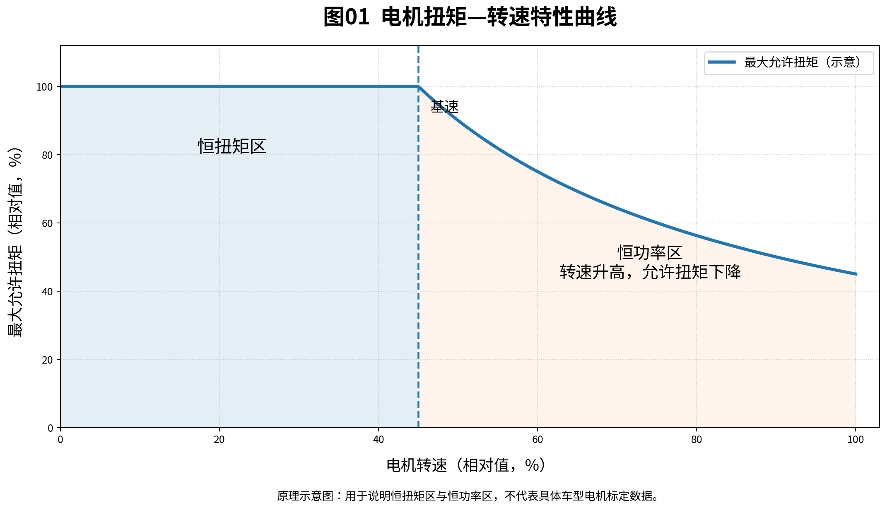
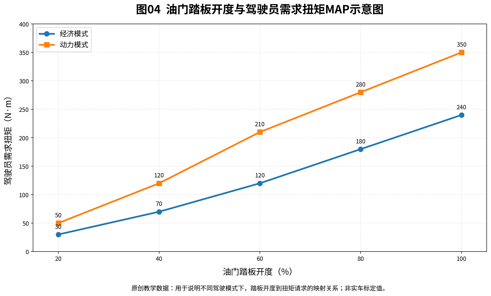

# 第10期 · VCU 动力系统常用公式：MATLAB 可复算练习

> 电池功率 → 功率限扭 → 轮端驱动力 → 整车加速度 → 再生制动限扭

**CSDN 第10期正文：**[新能源汽车VCU动力控制中的常用计算公式详解](https://blog.csdn.net/qian123456wang/article/details/170698701)

CSDN 负责解释物理意义、公式推导、单位、常见误区与算例；GitHub 重点提供**原创示例参数、可运行的 MATLAB 函数、结果检查与独立练习**，不复制文章全文。

## 1. 本实验解决什么问题？

看到电池端、电机轴端和车轮端的数据时，能否自己算清这些数的关系？本期按一条连续的数据链进行练习：

| 计算阶段 | 输入与处理 | 输出 |
| --- | --- | --- |
| 电池到电驱 | BMS允许功率扣除同边界辅助负载 | 电驱直流功率（kW） |
| 电驱到电机轴端 | 乘驱动效率，再用转速换算 | 功率限扭（N·m） |
| 正向扭矩仲裁 | 与驾驶员请求、MCU、电机及其他上限取最小值 | 电机轴端正向扭矩（N·m） |
| 电机到车轮 | 乘传动比与效率，再除车轮半径 | 轮端驱动力（N） |
| 整车受力 | 扣除滚阻、风阻和坡阻，再除质量 | 简化加速度（m/s²） |

此外练习根据 BMS 最大充电功率计算**再生制动扭矩幅值上限**。所有的机械扭矩均按电机轴端或车轮端明确标注，避免混用。

## 2. 目录说明

| 文件 | 用途 |
| --- | --- |
| `examples/demo_parameters.m` | 独立设计的电池、电机、车辆与回馈参数 |
| `examples/expected_results.txt` | 用公式独立计算得到的参考结果，不是 MATLAB 运行日志 |
| `matlab/calc_power_torque.m` | 电功率、轴端功率、正向限扭与回馈限扭计算 |
| `matlab/calc_vehicle_dynamics.m` | 车速、轮端扭矩、驱动力、平路及坡道加速度 |
| `matlab/plot_motor_curve_demo.m` | 从原创参数生成扭矩—转速曲线 |
| `matlab/run_all_examples.m` | 一键计算、打印结果、运行随参数变化的关系断言 |
| `figures/图01_电机扭矩转速特性曲线.png` | CSDN 正文图01：恒扭矩/恒功率原理示意 |
| `figures/图04_油门踏板开度与需求扭矩MAP.png` | CSDN 正文图04：原创踏板 MAP 示意 |
| `exercises/README.md` | 修改参数练习与问题解答 |
| `VALIDATION.md` | 已核对、未实测、后续验证条件 |

## 3. MATLAB 使用方式

只需要**基础 MATLAB**，核心算式不依赖 Simulink 或 AUTOSAR 工具箱。建议先不画图，仅运行数值计算。

在 MATLAB 命令窗口把当前文件夹切换到本期项目目录后执行：

```matlab
addpath(fullfile(pwd, 'matlab'));
addpath(fullfile(pwd, 'examples'));
results = run_all_examples(false);
```

如果需要同时用 MATLAB 重新绘制扭矩—转速曲线：

```matlab
results = run_all_examples(true);
```

生成的文件为 `figures/motor_torque_speed_generated.png`，代表实际在你本地 MATLAB 中运行代码后的输出；仓库预置的 `图01` 和 `图04` 是**已制作的教学示意图**，不是 MATLAB 实测截图。

> 尚未完成 MATLAB 运行验证。若运行时报错，记录 MATLAB 版本、报错信息与输入参数后再修改。不要将脚本的静态审阅写成“实际运行通过”。

## 4. 本期独立算例

用一套虚构数据贯穿计算全过程：

| 参数 | 教学取值 | 单位 |
| --- | ---: | --- |
| 电池电压 | 600 | V |
| 当前放电电流 | 125 | A |
| BMS允许放电功率 | 75 | kW |
| 其他高压负载功率 | 5 | kW |
| 电驱综合效率（驱动方向） | 0.90 | — |
| 电机转速 | 3000 | rpm |
| 驾驶员请求扭矩 | 260 | N·m |
| MCU允许驱动扭矩 | 240 | N·m |
| 电机正向扭矩上限 | 300 | N·m |
| 其他有效驱动扭矩限制 | 220 | N·m |
| 总传动比 | 10 | — |
| 传动效率（驱动方向） | 0.95 | — |
| 车轮有效滚动半径 | 0.5 | m |
| 整车质量 | 2500 | kg |
| 滚动阻力系数 | 0.012 | — |
| 空气阻力系数 | 0.30 | — |
| 迎风面积 | 2.5 | m² |
| 空气密度 | 1.225 | kg/m³ |
| 上坡坡度 | 10 | % |

关键计算链（四舍五入）：

- 电池当前电功率：`600 × 125 / 1000 = 75 kW`。
- 可分配电驱的直流功率：`75 − 5 = 70 kW`。
- 电机轴端机械功率：`70 × 0.90 = 63 kW`。
- 该转速下功率对应的扭矩限制：`9550 × 63 / 3000 = 200.55 N·m`。
- 扭矩仲裁结果：`min(260, 240, 300, 220, 200.55) = 200.55 N·m`。
- 轮端驱动力：`200.55 × 10 × 0.95 / 0.5 = 3810.45 N`。
- 理论车速：`56.55 km/h`；平路加速度约 `1.361 m/s²`，10%上坡约 `0.386 m/s²`。

### 公式边界，务必注意

1. 上例假设 BMS 的 75 kW 是需要覆盖所列 5 kW 辅助高压负载的电池端功率上限；若 BMS 已扣除该负载，不得重复相减。
2. 电驱效率与传动效率分别位于电池/电机侧和电机/车轮侧，不能把电池端功率当作轴端功率。
3. 用 `9550P/n` 反推扭矩只适用于非零转速；低速、零速按电机扭矩/电流能力处理。
4. 驱动 `min()` 仲裁只针对**同一轴端、同一正向扭矩定义**；回馈负扭矩的限制需分开处理。
5. 行驶阻力采用简化的恒参数模型，未计入旋转惯量、轮胎滑移、载荷转移、复杂电驱效率 MAP、坡道上的驱动附着变化等。
6. 10%坡度表示 `tan(theta)=0.1`，不是 10°。
7. 本例仅处理正转速下的前进驱动及回馈，负扭矩代表制动；倒车不在范围内。回馈效率覆盖电机轴端到电池直流端，充电功率用除以效率反推机械功率。回馈时不计辅助负载消耗，不额外放宽回馈能力；还与独立的MCU和电机发电扭矩上限取最小幅值。
8. `9550`是`60000/(2*pi)`的近似，产生约0.0074%的换算误差；需要严格能量平衡时应统一使用精确常数。
9. 所有数据仅用于算例，不得作为车辆控制参数直接使用。

## 5. 预置示意图与 MATLAB 自绘曲线



预置图01使用相对坐标，基速约为最高转速的45%；它只说明曲线形状，并不对应下面脚本的数值参数。曲线不是任何具体电机的真实特性。`matlab/plot_motor_curve_demo.m` 使用**另一组独立教学电机参数**绘制可复算曲线：最大扭矩400 N·m、最大功率100 kW、最高转速10000 rpm，基速约2387.5 rpm。

## 6. 为什么踏板开度与扭矩不是固定比例？



上图是某一固定工况下的独立教学MAP切片，仅展示20%～100%踏板区间，不定义零踏板扭矩，也未体现转速这一维度；不是本计算脚本的实际油门标定。驱动扭矩脚本直接采用指定的驾驶员请求扭矩260 N·m，主要练习**需求扭矩与有效上限仲裁**；踏板查表的完整实现可作为后续独立课题。

## 7. 运行与验证状态

请阅读 [VALIDATION.md](VALIDATION.md)。当前完成公式静态审阅、独立Python数值交叉核对与PNG完整性检查，**没有实际运行 MATLAB/Simulink、MIL、台架或实车验证**。发布时不得删除这个说明。

## 8. 延伸练习与关联内容

- [本期练习题](exercises/README.md)：修改电流、车速、坡度、质量、功率上限并观察结果。
- [CSDN 第10期公式详解](https://blog.csdn.net/qian123456wang/article/details/170698701)：原理推导、单位与更多例题。
- [返回车辆动力学分类](../README.md)
- [返回项目总目录](../../README.md)
- [返回仓库首页](../../../README.md)

## 9. 参考资料

- [MathWorks: Electric Vehicle Reference Application](https://www.mathworks.com/help/autoblks/ug/explore-the-electric-vehicle-reference-application.html)
- [MathWorks: Vehicle Body](https://www.mathworks.com/help/sdl/ref/vehiclebody.html)
- [MathWorks: MATLAB Function](https://www.mathworks.com/help/matlab/ref/function.html)

本项目只为基础公式学习与离线数值核对而设计，未实施车辆级安全功能及生产环境验证。
